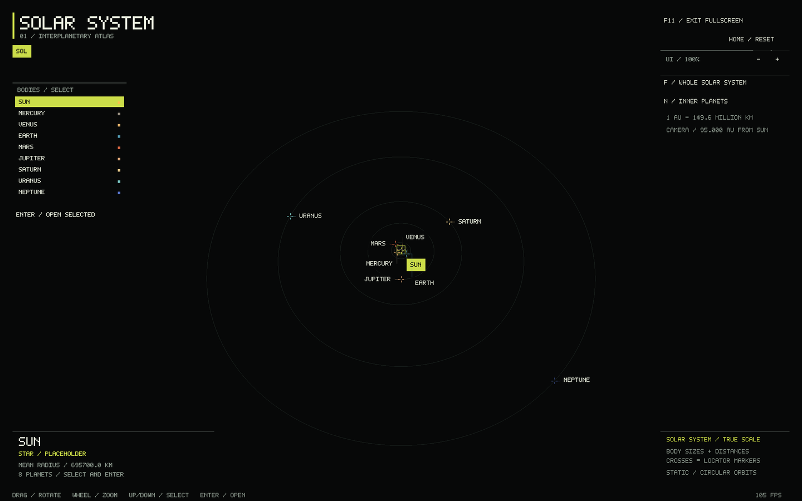
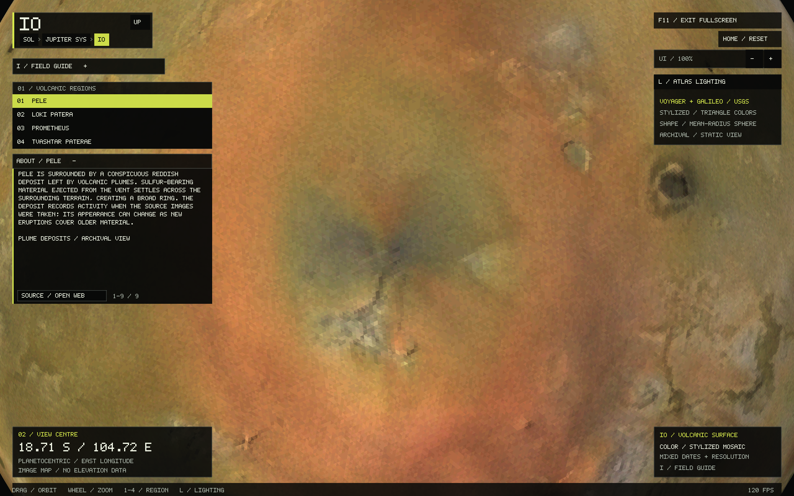
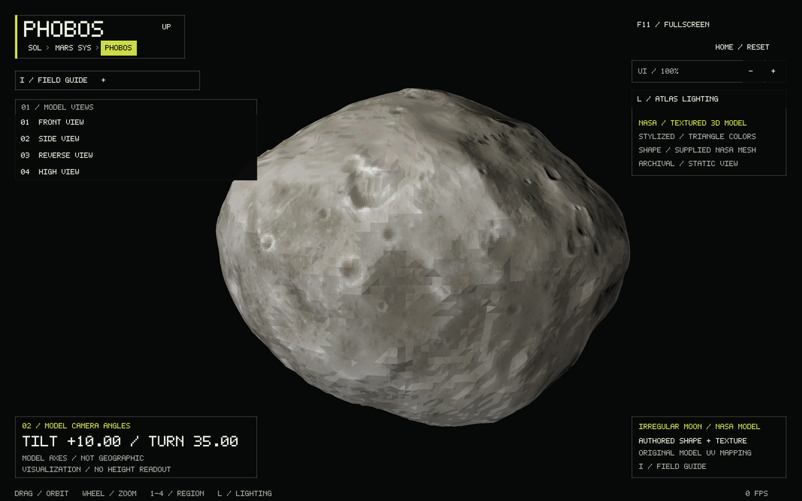
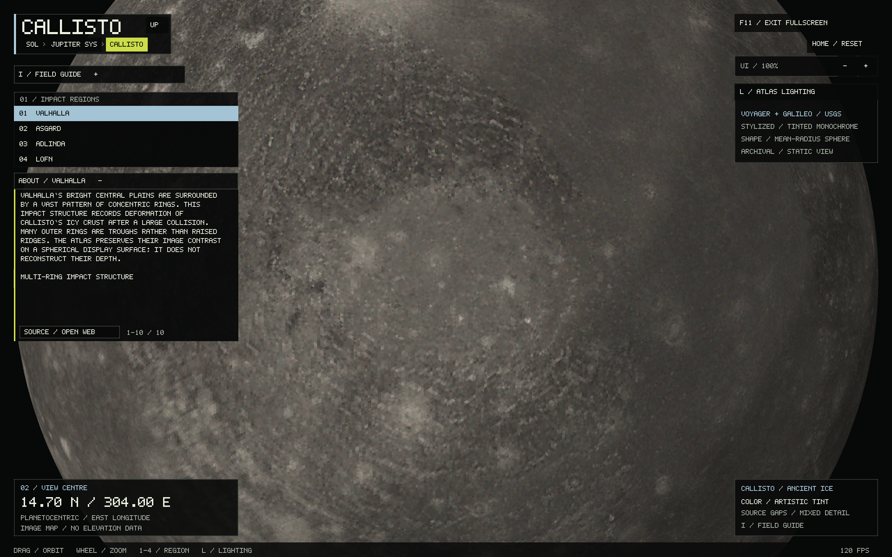
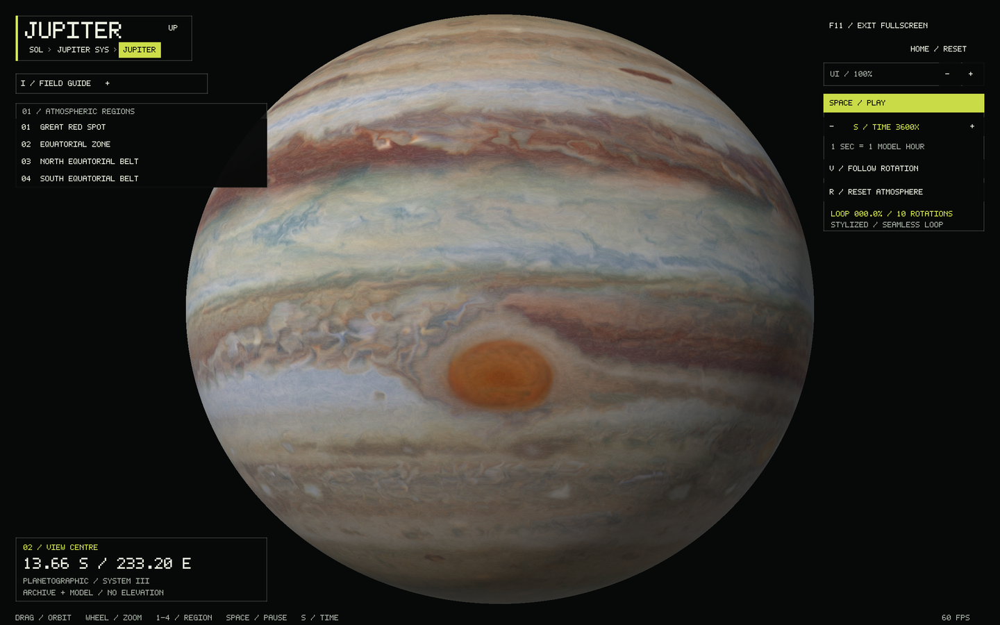
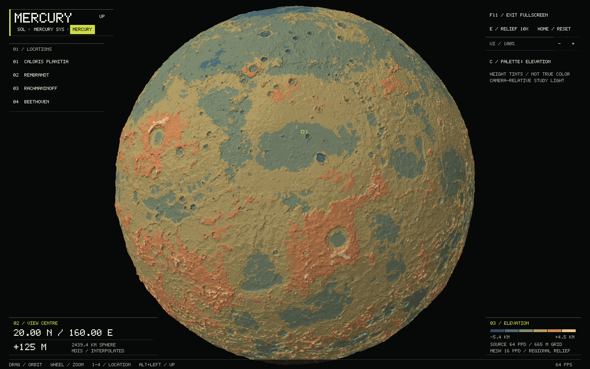
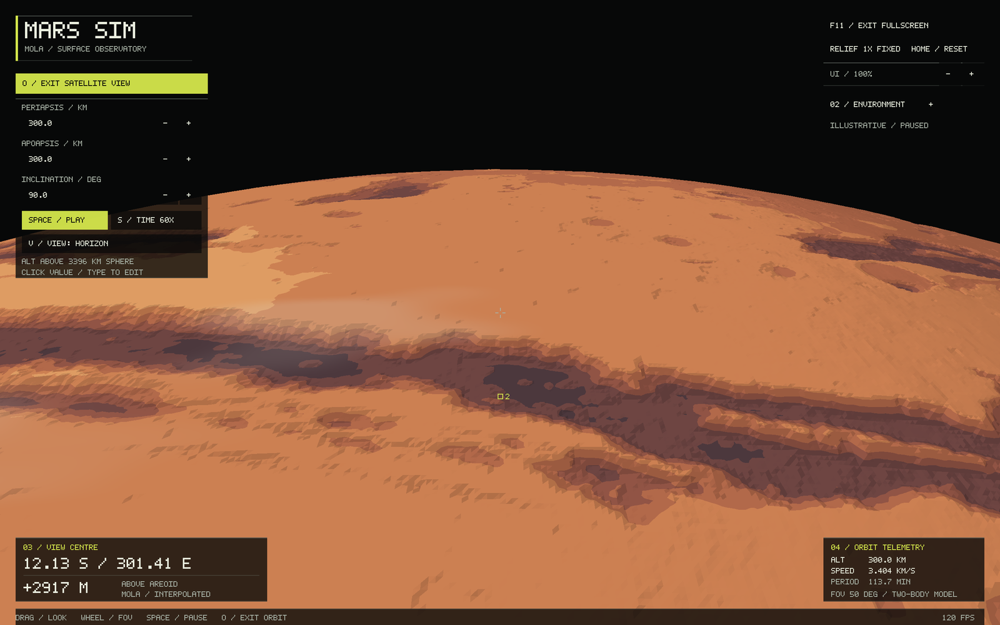

# Solar System Sim

A native, DS-inspired solar-system atlas built with **C++17, SDL3 and OpenGL 3.3**.
Explore a solar system at physical scale, open a planet and its included moons, then enter
an individual globe. Earth has a Blue Marble globe, NOAA topography and slow clouds on a seamless 60-second loop. Mars retains the full real-MOLA explorer, weather and satellite
mode. The Moon has real LOLA terrain, an 8K LROC-derived appearance map, and 16 destinations including all six Apollo landing sites. Mercury has a detailed MESSENGER/MDIS terrain globe, and Jupiter has a
detailed, Juno-inspired atmospheric globe with looping cloud bands and a Great Red Spot model. Venus has warm, hazy clouds and switchable Magellan terrain with inferred surface color. Io has a Voyager/Galileo surface atlas and four volcanic destinations. Callisto has a faceted impact atlas with four crater and basin destinations. Phobos and Deimos preserve NASA textured irregular models. Europa and Ganymede have faceted USGS image atlases and regional guides. Saturn has a golden atmospheric globe and textured, shadow-casting rings. Titan has amber haze and a surface toggle; the six other major Saturn moons have NASA textured models and field guides. Uranus and Neptune have detailed atmospheric globes, rings and major moon explorers.

This is an independent project. See [testing and release preparation](docs/RELEASE.md)
for reproducible checks and packaging instructions.



## Run the framework

The executable is already built on this machine:

```sh
cd /home/schady/Projects/solar_system_sim
./build/solar_system_sim --fullscreen
```

- Click a body, its floating label, or its entry in the left list to select it.
- **Enter**, double-click, or **Open selected** opens its system/globe.
- **Alt+Left**, **Up**, or an ancestor breadcrumb returns through the hierarchy.
- Drag to rotate; wheel or `+`/`-` to zoom within the current level. Up/down arrows
  select list entries on the new views. **Home** resets the current camera.
- **F11** toggles fullscreen, **Tab** hides overlays, **[ / ]** changes UI scale.
- **Escape** cancels a Mars numeric edit, otherwise leaves fullscreen or quits.

Examples:

```sh
./build/solar_system_sim --start system --body jupiter
./build/solar_system_sim --start globe --body europa
./build/solar_system_sim --start earth
./build/solar_system_sim --start mars
./build/solar_system_sim --start mercury
./build/solar_system_sim --start moon
./build/solar_system_sim --start jupiter
./build/solar_system_sim --start saturn
./build/solar_system_sim --start mars --orbit --orbit-paused
```

A planet opens its local system first; selecting its central body opens that
planet's globe. A moon returns to its parent planet's system. The Sun opens a globe
directly. Each view remembers its camera and selection for this session. Mars also
keeps relief, landmarks, weather settings and satellite configuration. Mars's
weather/orbit clocks stop while it is inactive or during a navigation transition.

The catalog includes the Sun, eight planets, 21 representative moons, five dwarf
planets, and the main asteroid belt and Kuiper belt regions.
The included-moon count is not a total astronomical moon count.

**The solar overview now uses one physical scale for body sizes and orbital
spacing.** **F / Whole solar system** frames all eight planets; **N / Inner
planets** frames Mercury through Mars. At this scale most planets are smaller
than a pixel in the full view, so labeled crosshair locators and the sidebar keep
them selectable. The HUD distinguishes locator markers from body sizes and shows
AU distances. The orbit guides are static circles at reference semimajor-axis
distances, with representative angular placements.

The **Mars, Saturn, Jovian and Earth–Moon systems** also use physical body sizes and
representative mean moon orbital distances. Other local systems retain their
labeled schematic layouts.
Globe views use independent camera scales. Placeholder surfaces remain identified
as such and report no invented elevation. See [solar scale, sources and controls](docs/SOLAR_SCALE.md).

## Earth explorer

Earth is built and ready. Open **Earth → Earth**, or run:

~~~sh
./build/solar_system_sim --start earth
~~~

NASA Blue Marble supplies a continuous 4096 × 2048 full-color surface map.
A 5.76-million-triangle indexed mesh follows the bundled NOAA ETOPO2022 grid,
with source-derived slope lighting that resolves mountain ranges and ocean ridges.
**T** removes the oceans and clouds to expose shaded land and seafloor topography,
with 1-km contours and a sea-level outline. **E** selects 1×/10× relief;
elevation readouts remain unexaggerated. **C** toggles the two cloud layers,
which use the NASA GEOS-5 reference with local wind shear, evolving fine detail,
translucent high clouds and directional shading on a seamless **60-second loop**.
**Space** pauses clouds; **R** restarts the loop. Topography restores the saved
cloud preference when switching back. **1–4** selects Mount Everest, the Mariana
Trench, the Grand Canyon, or Mauna Loa and opens its geography notes. Trench
selection reveals the ocean floor automatically. **I** opens Earth's geography guide.
All data is bundled; there is no new runtime dependency.

Earth's system now uses the real Earth/Moon size ratio and a representative
384,400-km centre-to-centre separation on one shared scale. **F** frames the whole
system; **A** approaches the selected body. Map/cloud controls work in this view, with relief
fixed at **1×** to retain physical proportions. Globe relief and camera settings
survive visits to the Moon.

[Earth sources, preparation, controls and verification](docs/EARTH.md).

## Moon explorer

The Moon is built and its data is prepared on this machine. Open **Earth → Moon**,
or launch it directly:

```sh
./build/solar_system_sim --start moon --fullscreen
./build/solar_system_sim --start moon --landmark 1 --location-info
```

Four pages contain all six Apollo landing sites, Tycho, Copernicus, Aristarchus,
Plato, Mare Imbrium, Reiner Gamma, Orientale, Tsiolkovskiy, South Pole–Aitken and
Shackleton. **, / .** or the list arrows change pages; **1–4** or a row selects a
destination on that page. Notes expand underneath. **I** opens the Moon's field
guide, **C** changes between the LROC appearance map and elevation colors,
**E** toggles 1×/10× relief, and **R** replays the archive scan.
**Alt+Left** returns to Earth; revisiting the Moon retains its camera and settings.

Default geometry is 16 samples/degree (33.2 million triangles, about 633 MiB GPU),
with scientific readouts interpolated from the full 64 ppd LOLA grid (~506 MiB RAM).
Use **--moon-detail 8** or **--moon-detail 4** for lighter geometry.
Apollo markers locate landing sites; the global grid cannot show landers or footprints.

See [Moon data, preparation, sources and limitations](docs/MOON.md).
No new runtime dependency was added.

## Venus explorer

```sh
./build/solar_system_sim --start venus
./build/solar_system_sim --start venus --venus-topography
```

**T / C** or the map button switches between an opaque animated cloud shell and
real Magellan terrain in inferred surface color, keeping the camera in place.
**E** selects 1×/10× relief in surface mode, **Space** pauses in cloud mode,
**R** restarts clouds or retries failed assets, and **1–4** visits four regions.
The cloud deck has warm ivory haze, broad shifting gradients and soft diffuse
lighting inspired by Venus's subdued visible-light appearance. Gentle motion
continues on a seamless 60-second loop, with cloud contrast gently emphasized
for readability.
Clouds are illustrative. The surface uses JPL's Magellan/Venera/Pioneer radar
composite in simulated ochre/brown hues, replacing the elevation-color palette.
Elevations remain measured Magellan data; gray marks altimetry gaps. Both Venus
assets are bundled and work offline. Surface data and its 240-MiB terrain mesh
load only when surface mode is first opened, then stay cached. Clouds remain
available if a surface asset is missing or corrupt.

[Venus controls, data source, preparation and limitations](docs/VENUS.md).

## Io volcanic atlas

```sh
./build/solar_system_sim --start io
./build/solar_system_sim --start io --landmark 1
```

Open **Jupiter → Io** to explore the bundled 4096 × 2048 USGS Voyager/Galileo
color mosaic on **1.31 million flat-shaded triangles**, with a DS-inspired palette
and Mars/Mercury-style lighting. **1–4** select Pele, Loki Patera, Prometheus and Tvashtar Paterae;
**I** opens the field guide, and **L** toggles atlas lighting. Region notes appear
beneath the list. Camera and lighting are retained when returning from Jupiter.
The same imagery appears on Io at its physical size in Jupiter's system.

This is an archival enhanced-color surface map on a reference sphere, with no
measured elevations or live eruption model. Polar interpolation and mixed image
dates/resolutions are labeled. Missing/corrupt maps can be retried with **R**.

See [Io controls, provenance, coordinates and checks](docs/IO.md).



## Phobos, Deimos, Europa and Ganymede

```sh
./build/solar_system_sim --start phobos
./build/solar_system_sim --start deimos
./build/solar_system_sim --start europa --landmark 1
./build/solar_system_sim --start ganymede --landmark 2
```

Phobos and Deimos retain NASA's irregular textured shapes, with four model-view
presets and explicitly labeled model camera angles. Europa and Ganymede use
4096 × 2048 USGS Voyager/Galileo mosaics on dense faceted spheres, with four named
regional destinations each. All four include lighting controls, field guides,
location notes, independent cameras, retry support and detailed system previews.
Use **1–4**, **L**, **I**, **Home**, drag and wheel as in Io and Callisto.

See [sources, coordinates, limits, preparation and checks](docs/SATELLITES.md).



## Callisto impact atlas

```sh
./build/solar_system_sim --start callisto
./build/solar_system_sim --start callisto --landmark 1
```

Open **Jupiter → Callisto** for **1.31 million flat-shaded triangles**, a
DS-inspired stone-and-ice palette and Mars/Mercury-style lighting. **1–4** visit
Valhalla, Asgard, Adlinda and Lofn; **I** opens the field guide and **L** toggles
atlas lighting. Camera, region and lighting survive navigation.

The bundled USGS Voyager/Galileo map is monochrome with an artistic tint.
Source gaps are marked as flat dark areas; the spherical geometry has no measured
terrain heights. Missing or corrupt maps can be retried with **R**.

See [Callisto controls, data and checks](docs/CALLISTO.md).



## Jupiter atmosphere

```sh
./build/solar_system_sim --start jupiter --fullscreen
```

The redesigned atmosphere combines the **native 3600 × 1800 Hubble cloud map**
with Juno-inspired folded filaments, blue-gray gaps, finer storm circulation and
cloud relief shading. Its **589,824 indexed triangles** retain subtle facets.
**Space** pauses, **S** cycles 1× / 60× / 600× / 3,600× time speed in both Jupiter
views, **V** switches Follow/Watch Rotation, and **R** resets time. **1** tracks
the Red Spot; **2–4** select the other atmospheric regions.
The left field guide and expandable region notes remain available.

The seamless artistic loop lasts 99.25 seconds at default speed and repeats ten
whole-planet rotations. Motion, added microstructure and polar clouds are
illustrative. Use `--jupiter-low` for fewer triangles.

In Jupiter's local system, moon radii and mean orbital distances now share the
same physical scale as Jupiter. **F / Frame whole system** shows all four orbits;
**A / Approach selected** brings the selected planet or moon close; **J** retains the Jupiter shortcut. Moon labels and the sidebar stay
selectable at their real, small sizes. Io and Callisto use their archival surface mosaics;
Europa and Ganymede use tinted USGS archival mosaics. The
Mars/Mercury comparison overlay has been removed.



See [Juno references, exact cloud data, system dimensions and controls](docs/JUPITER.md).

## Mars data and loading

The overview and all placeholder views work without any MOLA file. Mars loads
only when entered, preparing the CPU mesh on one SDL worker and uploading it on
the main thread. The GPU upload can briefly pause presentation. Afterward its
single terrain allocation is retained for fast return visits. Native detail keeps
**33,177,600 triangles**, about **633 MiB** of GPU terrain buffers; use `--detail 8`,
`--detail 4` or `--coarse` for less memory. CPU/GPU data overlap during preparation
can temporarily require about 1.3 GiB plus driver/framebuffer overhead.

Missing/corrupt data leaves navigation usable, displays an error, and logs the
specific cause. Prepare the file as below, then press **R** in Mars to retry.
Mars-related command-line options automatically start in Mars unless `--start`
or `--body` explicitly chooses another view; for example `--start solar --detail 4` applies
lower Mars detail when you eventually enter it. `--data` overrides the MOLA path.

## Detailed Mercury



Mercury is ready to run on this machine:

```sh
./build/solar_system_sim --start mercury --fullscreen
```

Its focused globe uses the corrected **MESSENGER MDIS global DEM V02**, with
64 ppd (~665-metre) source readouts and a 16 ppd mesh matching Mars's current
33.2-million-triangle detail. **1–4** visits Caloris, Rembrandt, Rachmaninoff and
Beethoven. **E** switches 10×/1× relief; **C** switches stone/elevation palettes.
Heights stay scientifically unexaggerated, above Mercury's 2,439.4-km reference
sphere. Both palettes are height tints; lighting is stylized. **Alt+Left** returns
to its system. Mercury and Mars retain independent cameras, settings and terrain.

For a fresh data setup, after building:

```sh
bash tools/download_mercury.sh
./build/mercury_convert data/source/mercury/MSGR_DEM_USG_SC_I_V02.LBL data/source/mercury/MSGR_DEM_USG_SC_I_V02.IMG data/mercury64.dem
```

The download is 506.25 MiB, verified against pinned hashes. It runs once, offline
from the app. Use `--mercury-detail 8` or `4` for lower mesh memory;
`--mercury-data` overrides the path. Retaining both default detailed globes uses
roughly 1.76 GiB plus driver/framebuffer overhead; preparation temporarily adds a
CPU mesh. Missing data shows a recoverable error with **R** to retry.

See [Mercury sources, conversion, Windows commands, scientific limits and checks](docs/MERCURY.md).

## Planet information and scanning

**I / Field Guide** opens the left-side planet dropdown for Mars, Mercury and Jupiter. It contains two
planet paragraphs, cycles, scoped temperature/wind figures, composition, gravity,
magnetism, orbital inclination, axial tilt and moon counts. Selecting a destination
in the globe's **Locations** list (or pressing **1–4**) expands its paragraph
directly beneath that list. Click its **About / location** header to collapse or
reopen the notes. Location descriptions are separate from the planet guide.
Scroll either panel with the wheel or PgUp/PgDn; Esc closes the active expansion.
**Source / Open Web** opens the cited primary source when clicked.

Entering a detailed Mars or Mercury globe presents an animated **archive scan** with elevation
contours and real loading-stage text. **R / Scan** replays the effect once ready;
R still retries unavailable data. It changes no measured heights.

Mars and Mercury have richer, source-derived **65,536-triangle system previews**,
bundled as small files in `assets/`. They work without loading the full globe files.
The solar-system overview remains lightweight. CMake copies these assets beside
the executable; keep that folder with it when moving a build.

```sh
./build/solar_system_sim --start mercury --info
./build/solar_system_sim --start mars --landmark 1 --location-info
./build/solar_system_sim --start system --body mars --scan
```

[Guide sources, scientific definitions, preview format and verification](docs/FIELD_GUIDE.md).

## Architecture and scope

| Module | Responsibility |
| --- | --- |
| `src/catalog.*` | Stable body IDs, parents, presentation styles, physical solar/Mars/Saturn/Jovian/Earth–Moon dimensions, remaining schematic placement, MOLA/MDIS dataset metadata |
| `src/navigation.*` | Three view types, saved cameras/selections, local coordinates and short transitions |
| `src/placeholders.*` | Shared 960-triangle sphere, ring/guide geometry, label placement and ray picking |
| `src/guide.*`, `src/renderer_guide.cpp` | Planet/location articles and scrollable dropdown |
| `src/earth.*`, `src/earth_view.*`, `src/renderer_earth.cpp`, `src/earth_shaders.hpp` | Lightweight Earth atlas and periodic clouds |
| `src/venus.*`, `src/venus_view.*`, `src/renderer_venus.cpp`, `src/venus_shaders.hpp` | Magellan topography, opaque flowing clouds, and Venus controls |
| `src/faceted.*`, `src/faceted_shaders.hpp` | Shared checked map loading, geodesic triangles and stepped lighting |
| `src/satellites.*`, `src/satellites_view.*`, `src/renderer_satellites.cpp` | Shared Phobos/Deimos NASA model and Europa/Ganymede USGS atlas explorer |
| `src/callisto.*`, `src/callisto_view.*`, `src/renderer_callisto.cpp`, `src/callisto_guide.hpp` | Tinted Voyager/Galileo Callisto map, impact regions, controls and guide |
| `src/io.*`, `src/io_view.*`, `src/renderer_io.cpp`, `src/io_shaders.hpp`, `src/io_guide.hpp` | Voyager/Galileo Io mosaic, volcanic regions, lighting controls and field guide |
| `src/preview.*`, `src/scan.hpp` | Small source-derived system models and archive scan state |
| `src/main.cpp` | SDL lifetime, global controls, view routing and CLI |
| `src/mercury.*`, `src/mercury_view.*`, `src/renderer_mercury.cpp` | MESSENGER DEM import/sampling, Mercury controls/loading and instruments |
| `src/jupiter*`, `src/renderer_jupiter.cpp` | Juno-inspired cloud rendering, native Hubble map, seamless loop and time/camera controls |
| `src/mars_view.*` | Existing Mars controls/state/readouts and on-demand data worker |
| `src/renderer.*`, `src/renderer_navigation.cpp` | Shared OpenGL resources, Mars rendering, placeholder rendering and custom HUD |
| `src/terrain.*`, `tools/mola_convert.cpp` | Existing verified MOLA conversion, sampling and terrain |
| `src/orbit.*`, `src/environment*` | Existing Mars satellite motion and illustrative weather |
| `src/ui.hpp`, `src/font.hpp`, `src/gl.hpp` | Shared layout, original pixel glyphs and SDL-based GL loading |

**Solar-system Milestone 1 is implemented:** navigable placeholders and the full
Mars integration. Mercury, Venus, Earth, the Moon, Jupiter, Phobos, Deimos and all four included Galilean moons now have dedicated explorers.
Other datasets, bounded terrain
LOD, sourced astronomical motion, physical lighting and the remaining moon surfaces
remain future work.
See [framework design and remaining scope](docs/SOLAR_SYSTEM_PLAN.md) and
[the inherited Mars design](docs/DESIGN.md).

SDL3 is the only direct third-party runtime dependency. OpenGL comes from the OS
GPU driver; entry points load through `SDL_GL_GetProcAddress`. There is no engine,
UI library, image library, geospatial framework, runtime network request or
automatic asset download. The three prepared terrain datasets and bundled system previews are local files. Keep the SDL3 DLL beside the executable on Windows.

## Build and run on Linux

Install a C++17 compiler, CMake ≥3.20, Make or Ninja, SDL3 development files ≥3.2,
and an OpenGL 3.3-capable driver. For Arch Linux:

```sh
sudo pacman -S --needed base-devel cmake sdl3 curl
```

If your distribution does not package SDL3, build the official SDL source as
described below; SDL2 is not a substitute. Run all project commands from this
directory.

**Increment 1 — build the offline data path.** This checkpoint needs no SDL or GPU:

```sh
cmake -S . -B build-data -DMARS_BUILD_APP=OFF -DCMAKE_BUILD_TYPE=Release
cmake --build build-data --target mola_convert -j
bash tools/download_mola.sh
./build-data/mola_convert data/source/megt90n000eb.lbl data/source/megt90n000eb.img data/mars16.mola
```

The download is just the official **33,177,600-byte 16 ppd topography IMG** and
its detached label. The script verifies pinned SHA-256 hashes and uses temporary
files. The converter refuses to overwrite an existing output; to reconvert,
choose another filename. No 128 ppd files are fetched.

**Increment 2 — build and run the native globe:**

```sh
cmake -S . -B build -DCMAKE_BUILD_TYPE=Release
cmake --build build -j
./build/solar_system_sim --data data/mars16.mola
```

**Increment 3 — verify the final integrated app and data:**

```sh
ctest --test-dir build --output-on-failure
./build/terrain_tests docs/megt90n000eb.lbl data/mars16.mola
./build/solar_system_sim --start mars --frames 120 --screenshot build/globe.ppm
./build/solar_system_sim --landmark 1 --frames 120 --screenshot build/olympus.ppm
```

The bounded frame mode runs the real renderer, checks GL errors and centre-depth
unprojection, saves an optional PPM, and exits. PPM needs no image-writing library.
The app also locates `data/mars16.mola` beside the executable or in its parent
directories; an explicit `--data` path is the most predictable option.

## Build and run on Windows

Use Visual Studio 2022 with the **Desktop development with C++** workload and
CMake. In a Developer PowerShell, obtain/build SDL3 once (official source, pinned
to a stable release):

```powershell
git clone --depth 1 --branch release-3.2.20 https://github.com/libsdl-org/SDL.git third_party/SDL
cmake -S third_party/SDL -B build-sdl -A x64 -DSDL_SHARED=ON -DSDL_STATIC=OFF -DSDL_TESTS=OFF "-DCMAKE_INSTALL_PREFIX=$PWD/deps/SDL3"
cmake --build build-sdl --config Release --parallel
cmake --install build-sdl --config Release

cmake -S . -B build -A x64 "-DCMAKE_PREFIX_PATH=$PWD/deps/SDL3"
cmake --build build --config Release --parallel
powershell -ExecutionPolicy Bypass -File tools/download_mola.ps1
.\build\Release\mola_convert.exe data/source/megt90n000eb.lbl data/source/megt90n000eb.img data/mars16.mola
.\build\Release\solar_system_sim.exe --data data/mars16.mola
ctest --test-dir build -C Release --output-on-failure
.\build\Release\terrain_tests.exe docs/megt90n000eb.lbl data/mars16.mola
```

CMake copies the shared SDL3 DLL beside `solar_system_sim.exe`. Keep it there when moving
the executable. No `opengl32` import-library dependency is needed by this code;
SDL loads the driver. The application has been run on Linux; Windows support is
implemented but has not been compiled or exercised on a Windows machine here.

The same SDL source approach works on Linux using `-DCMAKE_BUILD_TYPE=Release`
instead of `-A x64`/`--config Release`; install your distribution's SDL build
prerequisites first. See [SDL's official CMake guide](https://wiki.libsdl.org/SDL3/README-cmake).

## Mars controls

| Action | Input |
| --- | --- |
| Orbit | Left-drag in globe or arrow keys |
| Zoom | Wheel, `+` / `-` (including keypad) |
| Visit destination | Click a destination card or press `1`–`4` |
| Inspect elevation | Hover over terrain; outside terrain the readout follows the centre reticle |
| Switch 10× / 1× geometry | `E` or relief button in atlas mode; satellite mode uses 1× |
| Whole-planet view / leave orbit | `Home` or reset button |
| Enter / leave satellite view | `O` or satellite button |
| Orbital periapsis, apoapsis, inclination | Click a value, type, press `Enter`; or use its `−` / `+` buttons |
| Pause / resume satellite motion | `Space` |
| Satellite time scale | `S` or time button: 1×, 10×, 60×, 300× |
| Horizon / straight-down view | `V` or view button |
| Look around / optical zoom in satellite mode | Drag / wheel (25–90° vertical FOV) |
| Fullscreen / windowed | `F11` or fullscreen button; `Esc` leaves fullscreen |
| Hide / show all UI and markers | `Tab` |
| UI scale, 75–200% | `[` / `]` or the UI `−` / `+` buttons |
| Individual ice/cloud/dust toggles | Open `02 / ENVIRONMENT` |
| Clean topography / restore layers | `T` |
| Pause / resume weather | `P` |
| Preview a regional storm near the current view | `D` |
| Quit | `Esc` while windowed, or window close |

Mars now fills the entire window at the drawable's native resolution, with a
closer starting view and small translucent corner overlays. The app starts
maximized; F11 switches to borderless fullscreen. The charcoal/off-white interface
uses fine rules, numbered instruments and a restrained yellow accent. UI scale is
independent of terrain resolution. It changes in 25% steps relative to an automatic
base size, snaps drawing edges to native pixels, and fits to the available window
(`FIT` appears when constrained). Text strokes retain at least one native pixel.
Input uses the actual drawable size, including high-DPI displays. UI scale is a
session setting; use `--ui-scale` to choose the starting scale on later launches.
Four numbered markers correspond to the destinations. Base colours encode
elevation; ice and weather are explicitly illustrative overlays.

```sh
./build/solar_system_sim --fullscreen            # Start directly in fullscreen
./build/solar_system_sim --fullscreen --hide-ui  # Unobstructed planet; Tab restores UI
./build/solar_system_sim --windowed              # Start in an ordinary resizable window
./build/solar_system_sim --detail 8              # 0.125-degree mesh, lower memory cost
./build/solar_system_sim --detail 4              # Previous 0.25-degree terrain density
./build/solar_system_sim --coarse                # Lightest 0.5-degree terrain density
./build/solar_system_sim --fullscreen --ui-scale 1.5  # Larger instrument text
./build/solar_system_sim --environment-open --preview-storm  # Inspect the new layers
./build/solar_system_sim --topography            # Unobstructed elevation colours
```

The closer framing and larger viewport make Mars appear bigger. Native pixel
resolution makes the image sharper; the finer mesh improves relief at close zoom.
Zoom now spans 1.085–8 display radii, with a default distance of 2.68 (previously 2.9). The camera
stays clear of the highest 10× terrain. None of these changes creates new source
data, and extreme close-ups still expose the kilometre-scale source grid.

The default terrain spacing is now **4× finer in each direction**: 0.25° → 0.0625°,
roughly 2.1 million → **33,177,600 triangles**. All 16,588,800 MOLA samples become
vertices at their exact geographic pixel centres, plus two shared pole vertices.
This uses the existing prepared file; no new download or conversion is necessary.
Only visible draw batches are submitted, but the full mesh stays resident. GPU
terrain buffers use about **633 MiB**; startup temporarily holds the CPU mesh too.
Use `--detail 8` (158 MiB) or `--detail 4` (40 MiB) when memory is limited. These
options change terrain geometry, while rendering stays at native window resolution.

## Satellite orbit



Press **O** to enter the satellite camera. Mars rotates underneath an ideal
elliptical orbit, with faster motion near periapsis and slower motion near apoapsis.
The default 250 × 1500 km, 45° orbit runs at **60× simulation speed** so motion is
visible. **Space** pauses it independently of weather. **V** switches between a
forward horizon view and straight down; drag looks around and the wheel changes
optical field of view without changing the orbit.

The left panel accepts periapsis and apoapsis **altitudes in km above the 3396 km
reference sphere**, between 100 and 20,000 km, with periapsis ≤ apoapsis. Inclination
is relative to the Mars equator: **0° prograde equatorial, 90° polar, 180° retrograde**.
Click a number and type to replace it; `Enter` applies, `Esc` cancels, and Backspace
edits. Invalid values leave the current orbit intact. Step buttons change periapsis
by 50 km, apoapsis by 100 km and inclination by 5°. Edits immediately reshape the
ideal orbit at its current mean anomaly; they are not simulated engine burns.

Orbital view uses **1× relief**, preserving meaningful altitude/geometry alignment.
Telemetry shows current sphere-relative altitude, inertial speed and period. The
surface probe still reports MOLA metres above the areoid. If the view centre points
into space, the fallback is explicitly labelled `SUBSATELLITE`. `O` returns to your
previous atlas camera and relief setting; `Home` or a landmark also leaves flight.
Orbit settings last for the session; launch parameters can reproduce a setup:

```sh
./build/solar_system_sim --fullscreen --orbit
./build/solar_system_sim --fullscreen --orbit --periapsis 300 --apoapsis 300 --inclination 90
./build/solar_system_sim --orbit --periapsis 250 --apoapsis 3000 --inclination 45 --orbit-rate 10
./build/solar_system_sim --orbit --orbit-paused --nadir --orbit-phase 180
```

This is a two-body visual simulation, with constant Mars spin and an arbitrary
starting epoch, not a mission ephemeris. No drag, oblateness, moons or solar gravity
are modelled. Lighting/weather remain stylized. See [orbital model and sources](docs/ORBIT.md).

## Ice and weather

The environment menu controls **polar ice**, **thin clouds**, **dust storms**,
**clean topography**, **pause** and **storm preview**. Ice has a fixed, approximate
residual-cap footprint, with a larger northern cap; it changes colour and lighting,
not MOLA heights. Thin clouds slowly drift and change shape. A seeded regional dust
storm grows, spreads and fades over 60–120 visual seconds, with 4–7 quiet minutes
before the first event and between events. Automatic events may occur out of view;
`D` previews one near the camera immediately, even while paused. There are no global
storms or seasonal cap changes in this version.

These are **stylized visual layers, not measured current conditions or a climate
simulation**. MOLA is elevation data, not an ice/weather map. Weather display
altitudes accommodate 10× terrain exaggeration and are not physical altitude
readouts. `T` removes all three layers without losing individual toggle choices;
`Tab` hides only the UI. The elevation readout always samples the real MOLA grid.
Animation freezes while paused or minimized. No new assets, downloads or runtime
dependencies are needed. See [implementation and sources](docs/DESIGN.md).

## Scientific scope and checks

**Mars readouts are interpolated MOLA metres above the areoid, never exaggerated.**
The source is 16 pixels/degree (about 3.70 km north–south and at the equator).
The default display mesh now matches those 16 samples/degree (about 3.70 km at the
equator). Finer sampling of the existing grid does not create independent measurements. It is a regional atlas, not a metre-scale surface simulator. Close zoom
cannot reveal boulders, dunes, or rover-scale hazards. See
[exact dataset files, interpretation and limits](docs/DATA.md).

Manual verification for Mars (`--start mars`):

- Drag through a full rotation and zoom in/out; confirm a responsive globe and bounded zoom.
- Select Olympus Mons and Valles Marineris; confirm raised volcano and recessed canyons.
- Visit Hellas; confirm a negative elevation (about −6,041 m at its destination centre).
- Move over terrain, then empty space; confirm `POINTER` changes to `CENTRE` with no stale position.
- Toggle relief; shape changes while the **same centre coordinate** retains the same elevation.
- Cross longitude 0°/360° and inspect both poles; look for holes or split edges.
- Toggle F11, resize, and change display scale; buttons and pointer picking should stay aligned.
- Press Tab twice; all overlays disappear and return. Escape leaves fullscreen before quitting.
- Change UI scale with brackets and buttons, then resize; confirm controls fit and clicks stay aligned.
- Open Environment; toggle each layer, pause/resume, and preview a storm with `D`.
- Inspect the polar caps; use `T` to reveal elevation colours, then restore the layers.
- In clean topography mode, confirm the same centre readout; weather must not affect picking.
- Enter satellite mode; edit all three orbital values and confirm altitude, speed and period change.
- Test circular, polar and retrograde orbits; pause, switch views, look around and zoom the lens.
- Reject periapsis > apoapsis; `Esc` cancels a field before leaving fullscreen.
- Exit flight with `O`; confirm the previous atlas view and relief return.
- Try a missing/truncated data file; confirm a labeled unavailable-data view, a useful terminal error, retry and working Up navigation.

For detailed automated results and reproducible visual cases, see
[verification](docs/VERIFICATION.md).

## Saturn explorer

Open **Saturn → Saturn**, or run `./build/solar_system_sim --start saturn`.
NASA VTAD supplies the cloud and ring appearance. Jupiter’s atmospheric pipeline
adds subtle moving filaments, with a separate ten-rotation loop and an
illustrative northern polar hexagon. Saturn has its physical oblate shape and
major ring radii, transparent gaps, and shadows between the globe and rings.
**1–4** selects a region, **Space** pauses, **S** changes speed, **V** switches
between following rotation and watching it, and **R** resets the atmosphere.
[Saturn sources, controls and limits](docs/SATURN.md).

Mars’s system uses one scale for Mars, Phobos, Deimos and their mean orbital
distances. The moons retain their NASA irregular shapes at calibrated sizes;
locator crosses keep these tiny bodies selectable. **F** frames the system and
**A** approaches the selected body. [Mars proportions and sources](docs/MARS_SYSTEM.md).


## Saturn moons and space backdrop

All seven major Saturn moons now open detailed NASA visualization explorers.
Run `./build/solar_system_sim --start titan`, or select a moon in Saturn's system.
**T** switches Titan between its amber haze and surface visualization. The Saturn
system uses physical sizes and mean orbital distances: **F** frames all seven
moons, **N** frames the inner group, and **A** approaches the selected body, including rings when Saturn is selected.

A nearly black, sparse starfield now sits behind every view. Its dim stars follow
camera direction and retain the large empty areas of space.
[Moon sources, scale, controls and backdrop details](docs/SATURN_MOONS.md).


## Sun

The Sun has a glowing, granular photosphere, flaring active regions, streaming
corona and expanding plasma ejections. Irregular sunspot groups grow, drift and
fade; the scale panel conveys the star's size. **1 / 2 / 3** select closeup, corona or
full Sun views; **Space / S / R** pause, change speed or restart the
90-second activity loop. Open it from the overview or use `--start sun`.
[Controls, sources and interpretation](docs/SUN.md).

## Approach a selected body

In a planet system or the solar overview, selecting a body in the sidebar,
clicking its locator, or using the selection arrows automatically moves and
zooms the camera toward it. The camera fits its physical size, with room for
rings when a ringed planet is selected. Drag and wheel controls then orbit and
zoom around that body. **A** and the approach button can reframe it again.
**F** restores the whole view; **N** restores the inner view where available,
and **Home** resets the camera. **Enter** opens its system or individual globe;
returning restores the overview's close view.

## Uranus and Neptune

Both ice giants have 589,824-triangle atmospheric globe explorers, checked
2048 × 1024 cloud textures and seamless layered gas flow, plus faint rings,
physical flattening and axial tilt. Uranus includes Miranda, Ariel, Umbriel, Titania and
Oberon; Neptune includes Triton's NASA visualization and a clearly labeled,
untextured Proteus reference sphere. Local sizes and orbital distances use one
physical scale. **F / N / A** frame the system; **Space / S / R** control the
independent atmospheric clocks. Run `--start uranus`, `--start neptune`, or a
moon name. [Sources, proportions and coverage limits](docs/OUTER_WORLDS.md).

The Sol overview now includes one-click **main asteroid belt** and **Kuiper belt** entries beneath the planet list. Belt dots appear only in their dedicated region views. Explore sparse orbital distributions, select dwarf planets to approach automatically, and press Enter to open **Ceres, Pluto, Haumea, Makemake or Eris**. F returns to the whole region. Ceres/Pluto use NASA visuals; the three unvisited worlds use labeled reference shapes, including Haumea's elongated figure and ring. Orbital distances and body sizes share one scale in each region. Details, sources and limits: [docs/BELTS.md](docs/BELTS.md).
