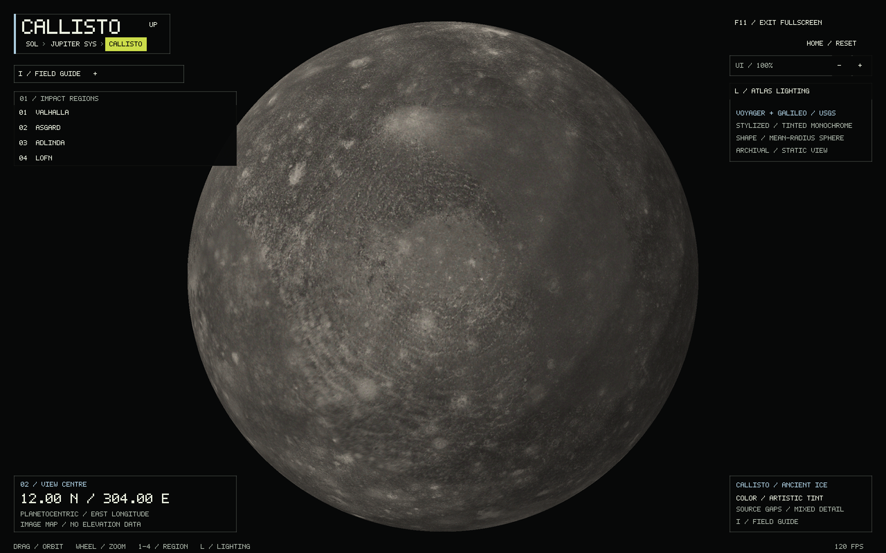
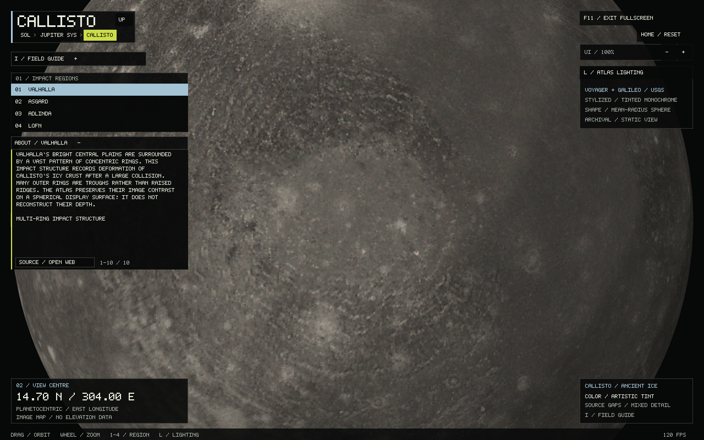

# Callisto: faceted impact atlas

Open **Jupiter → Callisto**, or run:

```sh
./build/solar_system_sim --start callisto
./build/solar_system_sim --start globe --body callisto --landmark 1
./build/solar_system_sim --start callisto --callisto-unlit --info
```

Callisto uses **1,310,720 flat-shaded geodesic triangles**, a restrained stone-and-ice
palette and the stepped diffuse lighting used by Io, Mars and Mercury. Each face
has one 5-bit RGB color with a fixed ±5% brightness variation. The source supplies
the crater patterns; the tint is artistic. Geometry is a reference sphere without
measured elevations. Close views keep the triangles visible; poles have the same
geodesic tessellation as the rest of the globe.

| Control | Action |
| --- | --- |
| Drag / arrows | Rotate |
| Wheel / + / − | Zoom |
| 1–4 / region buttons | Valhalla, Asgard, Adlinda, Lofn |
| L / lighting button | Stepped atlas lighting or unlit facets |
| Home | Reset camera |
| I | Field guide |
| R | Retry a missing or corrupt map |
| Alt+Left / Up / breadcrumbs | Return to Jupiter's system |

Region notes open beneath the list. Notes and the guide scroll independently.
Camera, selected region and lighting survive navigation, including visits to Io.
The standard latitude, longitude, distance, screenshot, frame-limit and UI-scale
options work. The bundled map works offline and loads on first entering Callisto
or Jupiter's local system. The cached geometry occupies 60 MiB of GPU memory;
CPU image and mesh staging are released after upload. Io and Callisto share map
validation, tessellation and shaders, with independent camera and loading state.





## Source and display treatment

The input is the USGS
[Callisto Galileo/Voyager Global Mosaic 1km](https://astrogeology.usgs.gov/search/map/callisto_galileo_voyager_global_mosaic_1km),
credited to NASA/JPL/USGS. Its single band combines Voyager and Galileo SSI images.
Source resolution ranges from about 400 metres to 60 kilometres per pixel, so
fine detail varies substantially. The 15,138 × 7,569 raster is reduced with Lanczos
to 4,096 × 2,048, approximately 3.7 km per equatorial display pixel. It remains
an archival image mosaic, with source lighting, seams, gaps and uneven coverage.

For each grayscale byte `v > 0`, the offline converter uses `t = (v / 255)^0.72`
and RGB `round(14 + 224t, 13 + 214t, 12 + 198t)`. This single brightness ramp
provides muted warm gray terrain and pale impact deposits. It is not measured
natural color, composition or an elevation palette. The TIFF marks zero as
no-data; these pixels become plain charcoal `(35, 36, 35)`. Missing polar areas
receive no invented crater detail. The HUD and guide identify source gaps.
Atlas lighting is camera-relative and does not represent the Sun's position.

## Coordinates and destinations

The GeoTIFF is simple cylindrical, centered on **180° east**. Its columns run
from 0° to 360° east and rows from north to south. The converter shifts each row
by half its width to the renderer's −180° to +180° convention. It does not mirror
the raster. Valhalla's rings, Asgard's bright interior and the southern Lofn
complex verify the registration.

The projection radius is 2,409,300.0488 metres, the upper-left corner is
(−7,569,039.333604, +3,784,519.666802) metres, and pixels are 1,000.005197 metres.
The [USGS Gazetteer](https://planetarynames.wr.usgs.gov/SearchResults?Target=24_Callisto)
lists planetographic, west-positive regional coordinates. For the spherical
viewing anchors we keep latitude and convert `east = 360 − west`; these are
approximate regional positions, not surveyed surface targets.

| Region | Latitude | East longitude | Reference |
| --- | ---: | ---: | --- |
| Valhalla | +14.70° | 304.00° | [USGS](https://planetarynames.wr.usgs.gov/Feature/6284) |
| Asgard | +32.20° | 220.10° | [USGS ringed features](https://planetarynames.wr.usgs.gov/SearchResults?Feature+Type=21_Large+ringed+feature&Target=24_Callisto) |
| Adlinda | −48.50° | 324.40° | [USGS](https://planetarynames.wr.usgs.gov/Feature/54) |
| Lofn | −56.50° | 337.70° | [USGS](https://planetarynames.wr.usgs.gov/Feature/3451) |

The existing [Jupiter-system scale](JUPITER.md) uses a 2,410.30-km mean radius and
1,882,700-km representative orbital radius for Callisto. Its zero-longitude face
points toward Jupiter in the static system layout. The same faceted map appears
in that view at Callisto's physical size; sidebar and label picking remain useful
when the moon is only a few pixels across. System framing and moon selection are
retained when returning. Orbital motion, eclipses and libration are not modeled.

## Rebuild the bundled map

Python 3 and ImageMagick are offline preparation tools only:

```sh
mkdir -p data/source/callisto
curl --fail --location --output data/source/callisto/Callisto_Voyager_GalileoSSI_global_mosaic_1km.tif \
  https://planetarymaps.usgs.gov/mosaic/Callisto_Voyager_GalileoSSI_global_mosaic_1km.tif
python3 tools/prepare_callisto.py \
  data/source/callisto/Callisto_Voyager_GalileoSSI_global_mosaic_1km.tif \
  data/source/callisto/callisto-prepared.rgb
```

The converter refuses an existing output or a source with a different SHA-256:
`e1f0bd2e0e05de605d067d6b5f5ededddaf31ca6c064562a1ca770f15a7dbaa3`.
After checking the regenerated map, copy it to `assets/callisto-voyager-galileo.rgb`
and rebuild; CMake copies assets beside the executable.

The header is `CALLISTO_RGB 1 4096 2048 d004ac4efeed414e\n`, followed by exactly
25,165,824 RGB8 bytes. The final field is the payload's 64-bit FNV-1a checksum.
The runtime validates signature, version, dimensions, checksum and exact length.
If loading fails, navigation remains usable. Restore the asset and press R on
Callisto; the terminal reports the failing path and reason.

## Field-guide references

- [NASA Callisto facts](https://science.nasa.gov/jupiter/jupiter-moons/callisto/facts/):
  ancient cratered surface, synchronous rotation, tenuous exosphere and the
  uncertain possibility of a deep ocean.
- [Valhalla's rings](https://science.nasa.gov/photojournal/the-valhalla-multi-ring-structure-on-callisto/).
- [Asgard's structure](https://science.nasa.gov/photojournal/asgard-multi-ring-structure-on-callisto/).
- [Greeley, Heiner and Klemaszewski (2001), Geology of Lofn Crater](https://ntrs.nasa.gov/citations/20030018897):
  Lofn's impact deposits and relation to Adlinda and Heimdall.

## Verification

`callisto_tests` checks map orientation at four independent anchors, source-gap
colors, geodesic winding and radii, flat 5-bit colors, invalid assets, controls,
scaled HUD hit areas, guide wrapping, and Jupiter navigation with saved framing.
The Io suite also exercises the shared faceted renderer's CPU path.

The Release build and all 12 CTest suites passed. Native OpenGL checks covered
all destinations, lighting controls, guide scrolling, 200% UI scale, both poles,
the longitude seam, and Callisto → Jupiter → Io → Jupiter → Callisto navigation.
A settled Callisto/Jupiter round trip reproduced the same pixels outside the FPS
footer. A separate Io comparison was pixel-identical before and after extraction
of the shared renderer. Missing and corrupt map recovery passed in an isolated
fixture, retaining the camera and avoiding a second upload after recovery.
The 1,710-frame native interaction tour averaged 116 FPS on the test Radeon 680M
at 2560 × 1600; this is a local check, not a performance guarantee.

```sh
ctest --test-dir build --output-on-failure
./build/solar_system_sim --start callisto --landmark 1 --fullscreen --frames 90 --screenshot build/callisto.ppm
./build/solar_system_sim --start callisto --landmark 4 --ui-scale 2 --frames 90
./build/solar_system_sim --start callisto --lat -90 --frames 90
./build/solar_system_sim --start callisto --lon 180 --distance 1.18 --frames 90
```
