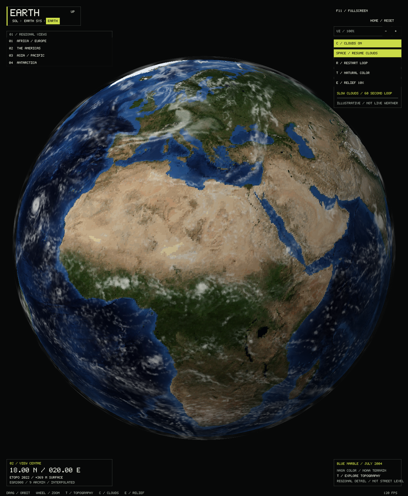
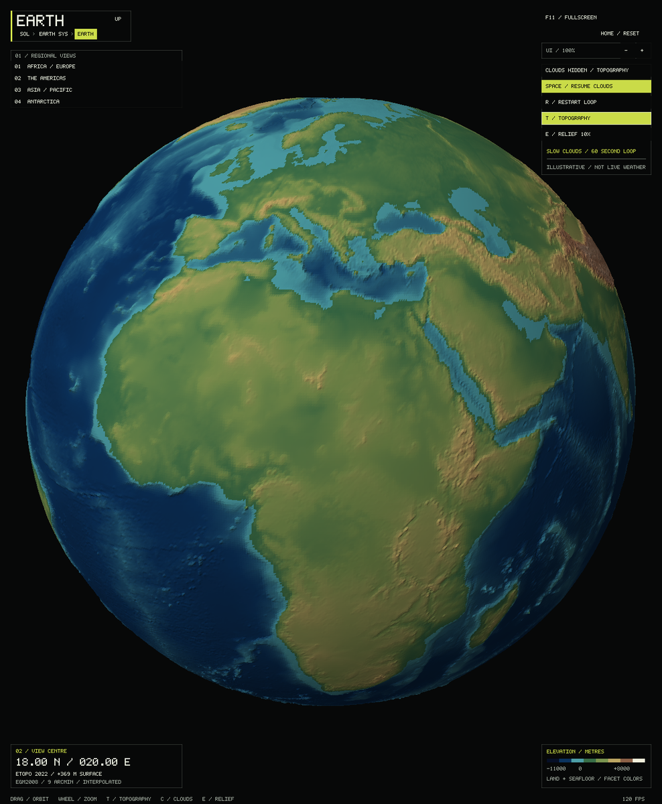
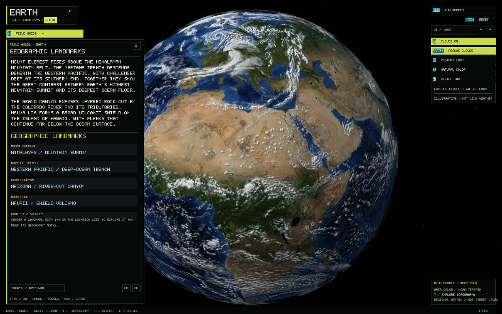
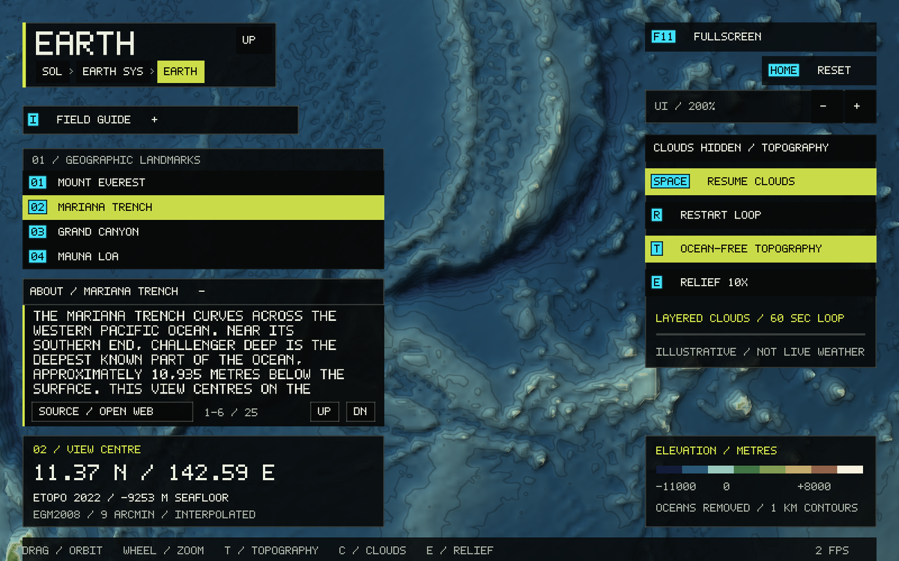
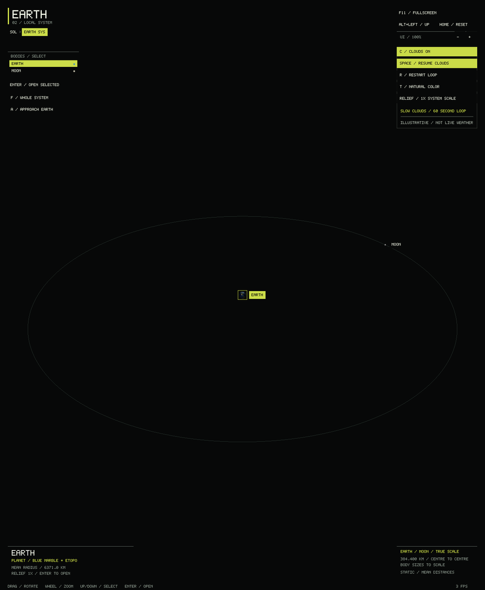
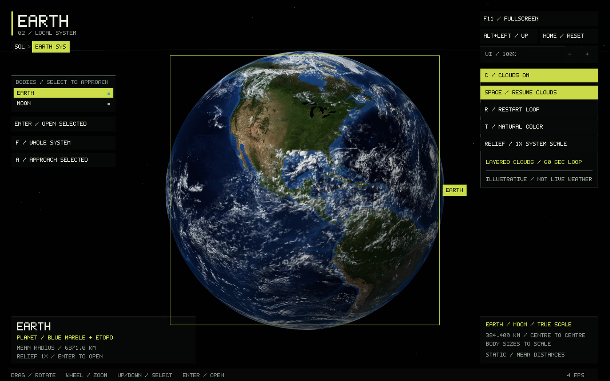

# Earth: natural color, topography and slow clouds

~~~sh
./build/solar_system_sim --start earth
~~~



Earth uses a continuous, full-color 4096 × 2048 surface texture and a
5,760,000-triangle indexed relief mesh matched to the bundled 2400 × 1200 DEM.
Per-pixel slope lighting reveals measured terrain rather than flat triangle colors.
Ocean-free topography exposes signed seafloor elevations with shaded hypsometric
colors, anti-aliased 1-km contours and a sea-level outline. All assets are bundled;
the native app needs only the existing SDL3/OpenGL stack.

- **T** switches natural color / topography, including ocean-floor relief.
- **E** switches **10× / 1×** vertical exaggeration. Readouts always give the
  original, unexaggerated elevation, rounded to metres, relative to EGM2008.
- **C** toggles clouds in natural color. Topography hides them for readability
  and restores the saved cloud preference when returning to natural color.
- **Space** pauses/resumes clouds; **R** restarts their 60-second seamless loop.
- **1–4** selects Mount Everest, Mariana Trench, Grand Canyon, or Mauna Loa.
  Selecting Mariana Trench enables ocean-free topography. **I** opens the
  geography guide; each selection opens its own notes and source link.
  Drag/arrows orbit; wheel/+/- zoom;
  **Home** resets the camera. **Alt+Left / Up** returns to Earth's system.

Map and cloud controls also work in Earth's system view while Earth is selected.
Selecting the Moon hides the Earth panel and disables its shortcuts; Earth's
saved settings are restored when Earth is selected again. Whole-system and
approach controls remain available for either body. That view always uses
**1× relief**, preserving physical proportions; **E** changes only focused-globe
relief. Camera and settings survive visits to the Moon. The cloud clock holds outside Earth/solar
views, while minimized, during transitions, or when paused.



## Geographic landmarks



Earth's guide and destination list focus on physical geography. Each landmark
has a camera anchor, a short explanation of its landform, geographic facts, and
an explicit source link. The full guide lists those same four locations, without
orbital, atmospheric or planetary specification tables. Number keys and clicks
focus the feature and open inline notes; normal-color and topography modes remain
available. Mariana Trench selection automatically removes the ocean to expose
its relief while preserving the saved cloud visibility preference.

| Key | Landmark | Regional camera anchor | Primary reference |
| --- | --- | --- | --- |
| 1 | Mount Everest | 27.99° N, 86.93° E | [NASA Earth Observatory: The Eight-Thousanders](https://science.nasa.gov/earth/earth-observatory/the-eight-thousanders/) |
| 2 | Mariana Trench / Challenger Deep area | 11.37° N, 142.59° E | [NOAA: How deep is the ocean?](https://oceanservice.noaa.gov/facts/oceandepth.html) |
| 3 | Grand Canyon | 36.10° N, 112.10° W | [National Park Service: Grand Canyon geology](https://www.nps.gov/grca/learn/nature/grca-geology.htm) |
| 4 | Mauna Loa | 19.475° N, 155.608° W | [USGS: Mauna Loa](https://www.usgs.gov/volcanoes/mauna-loa) |

References checked 2026-10-01. Camera anchors locate the features, not a specific
survey station. The 9-arc-minute elevation grid shows regional relief; its sample
at a camera anchor is not the cited summit or maximum trench-depth measurement.

```sh
./build/solar_system_sim --start earth --info
./build/solar_system_sim --start earth --landmark 1 --location-info
./build/solar_system_sim --start earth --landmark 2 --location-info
```



## Earth–Moon system scale



**F / Whole system** frames the lunar orbit; **A / Approach Earth** moves closer
without enlarging either body. Matching buttons sit below the body selector.
The wheel spans both views. Home resets the whole-system camera, and returning
from either globe restores the saved system framing and selection.

The two bodies and their separation use the same scale: **one scene unit =
100,000 km**. Spherical mean radii are **6371.0 km** for Earth and **1737.4 km**
for the Moon; the Moon is about **27.27%** of Earth's diameter. Its reference
centre-to-centre separation is **384,400 km**, about **30.17 Earth diameters**.

- [NASA Moon/Earth fact sheet: volumetric mean radii](https://nssdc.gsfc.nasa.gov/planetary/factsheet/moonfact.html)
- [JPL definition of a lunar distance: mean semimajor axis](https://ssd.jpl.nasa.gov/glossary/LD.html)

Retrieved 2026-09-28. The orbit guide is a static circle at that representative
mean distance, with an authored angular position; it does not claim today's
lunar position, elliptical motion or inclination. The HUD says **TRUE SCALE**,
**384,400 KM / CENTRE TO CENTRE**, and **STATIC / MEAN DISTANCES**. Body labels,
selection outlines and generous click targets remain legible without enlarging
body geometry. Both relief previews use unexaggerated heights at system scale.

Independent bounded local coordinates avoid astronomical-magnitude floats.
The local camera ranges from 0.175 to 14 units, with whole-system framing at 11
and Earth approach at 0.22; even transitions stay within the existing depth
range. Focused globes retain their independent unit-radius cameras. Earth's
solar-overview radius remains the documented equatorial radius from JPL;
the local Earth/Moon spheres use mean radii matching their terrain references.

## Layered dynamic clouds

The cloud shapes use one NASA **GEOS-5 atmospheric-model visualization** frame.
Two independently advected layers preserve fronts and curved storm systems while
periodic latitude shear and local deformation animate their shapes. Three scales
of noise erode cloud edges and add billowing detail; the upper layer is thin and
translucent. Sunward density samples add directional self-shading, while the
lower layer casts shadows on the surface. These added details and motions are
illustrative, not additional weather measurements or a forecast.

Motion uses a closed 60-second path with integer harmonics, including matching
velocity at the loop boundary. Pause and deterministic phase captures work for
both layers. A dedicated 512-column shell stays above the terrain even at the
Earth–Moon system's true scale; the coarse overview sphere is unsuitable because
its triangle chords would cut through Earth and hide clouds.

- [NASA SVS visualization 3837, description and credits](https://svs.gsfc.nasa.gov/3837/)
- [Exact reference: clouds.0350.tif](https://svs.gsfc.nasa.gov/vis/a000000/a003800/a003837/frames/2048x1024_2x1_30p/Clouds/clouds.0350.tif)

Credit: NASA Scientific Visualization Studio; visualization by Cindy Starr;
GEOS-5 atmospheric model. Only the reference's 2048 × 1024 alpha channel is
extracted, as cloud opacity. Its RGB values are not interpreted as measurements.
The display longitude placement and subsequent motion are illustrative.

The layers use nominal illustrative altitudes of 10 and 16 km, multiplied by the
selected relief factor to stay above displayed mountains. They do not write
probe depth. System-view layers use their unexaggerated nominal altitudes.

## NOAA elevation data

Source: **ETOPO 2022 v1, 60-arc-second Ice Surface elevation**, including
bathymetry. The display uses a **9-arc-minute point subset**, about **16.7 km**
north–south and at the equator. This is sufficient for regional mountain ranges
and ocean basins, not summit heights, coast surveys or ground-level exploration.

- [NOAA ETOPO product and citation](https://www.ncei.noaa.gov/products/etopo-global-relief-model)
- [ETOPO 2022 User Guide, revision 1.2](https://www.ngdc.noaa.gov/mgg/global/relief/ETOPO2022/docs/1.2%20ETOPO%202022%20User%20Guide.pdf)
- [Exact dataset and variable metadata](https://www.ngdc.noaa.gov/thredds/dodsC/global/ETOPO2022/60s/60s_surface_elev_netcdf/ETOPO_2022_v1_60s_N90W180_surface.nc.html)
- [Archived attributes](earth/etopo2022.das) and [subset SHA-256 hashes](earth/etopo2022-subset-sha256.json).

Cite: NOAA National Centers for Environmental Information (2022), *ETOPO 2022
15 Arc-Second Global Relief Model*, [doi:10.25921/fd45-gt74](https://doi.org/10.25921/fd45-gt74), accessed 2026-09-28.

The metadata identifies `z` as Float32, positive-up metres, EGM2008 vertical
datum (EPSG:3855), WGS84 geographic coordinates, and nodata **-99999**; there is
no scale/offset attribute. The underlying 60-second grid is 21600 × 10800,
cell registered. Its actual NetCDF latitude array ascends south to north,
unlike the north-down GeoTIFF transform also recorded in its metadata.
The converter reads and validates the returned coordinate arrays rather than
assuming row order from the filename or transform.

Ten small OPeNDAP requests retrieve the same 2400 × 1200 subset in latitude
strips. For strip `i = 0..9`, append this expression to the dataset's `.dods` URL:

~~~text
?z[4+1080*i:9:1075+1080*i][4:9:21595]
~~~

The script substitutes integer indices (the server is not given arithmetic).
The delivered point centres span latitudes -89.925..+89.925 and longitudes
-179.925..+179.925, at 0.15° spacing. Requests total roughly 12 MB and avoid
fetching the 478-MB original file. The dataset catalog inherits an obsolete
ETOPO1 summary; the exact ETOPO2022 filename, variable metadata and 2022 user
guide above define the product used here.

[DAP2 encoding documentation](https://docs.opendap.org/index.php/ProgrammerGuideChapter6)
defines the response's DDS followed by XDR arrays. The converter checks both
array counts, decodes big-endian Float32 heights and Float64 coordinates, rejects
missing/nonfinite/out-of-range samples and checks file hashes. It reverses rows
and rounds to signed whole metres (at most 0.5 m rounding error). Subsampling
retains point values, not block averages; small peaks and trenches can be missed.

Runtime `EARTH_DEM 1 2400 1200 <FNV1a>` plus newline precedes little-endian signed
16-bit metres. Rows run north to south; longitude increases west to east:
`lon = -180 + (x+.5)*.15`, `lat = 90 - (y+.5)*.15`.
CPU readouts interpolate this grid with longitude wrapping and common pole
averages. The local display sphere has a 6371-km reference radius; displacement
is `height * exaggeration / 6371000`. Natural color holds negative heights at
its sea-level sphere; topography exposes their signed ocean-floor relief.
The 2400-column mesh samples the DEM at its native bundled spacing of 0.15°
(about 16.7 km at the equator). Shared vertices and common poles preserve watertight
geometry. The GPU samples the elevation grid for continuous colors and finite-
difference terrain normals; no procedural elevation detail is added. Coordinate
readouts interpolate the same source grid independently of colors and relief.
This regional dataset does not resolve individual summits or street-level terrain.

## NASA surface appearance

- [Blue Marble: Next Generation](https://science.nasa.gov/earth/earth-observatory/blue-marble-next-generation/)
- [July 2004 topography/bathymetry color map](https://assets.science.nasa.gov/content/dam/science/esd/eo/images/bmng/bmng-topography-bathymetry/july/world.topo.bathy.200407.3x5400x2700.jpg)

Credit: NASA Earth Observatory / Blue Marble: Next Generation. This RGB image
supplies appearance only; it is never used to infer elevations. The 5400 × 2700
source is reduced to 4096 × 2048 RGB without palette quantization or color
modulation. Mipmapped filtering preserves continuous color across mesh faces,
with seam-aware texture derivatives at the dateline. Greenwich is at the image's
horizontal centre, north at the top. The approximately 10-km equatorial pixels
are archival appearance, not current land cover or a seasonal weather map.

## Reproduction and building

Prepared assets are already included. Python 3 and ImageMagick are needed only
to regenerate appearance assets; the elevation converter uses Python's standard
library. Run from the project root, choosing new output filenames:

~~~sh
bash tools/download_earth_topography.sh /tmp/earth2022.dem
curl --fail --location 'https://svs.gsfc.nasa.gov/vis/a000000/a003800/a003837/frames/2048x1024_2x1_30p/Clouds/clouds.0350.tif' -o data/source/earth/clouds.0350.tif
python3 tools/prepare_earth.py data/source/earth/clouds.0350.tif /tmp/earth-clouds.gray --clouds
curl --fail --location 'https://assets.science.nasa.gov/content/dam/science/esd/eo/images/bmng/bmng-topography-bathymetry/july/world.topo.bathy.200407.3x5400x2700.jpg' -o data/source/earth/world.topo.bathy.200407.3x5400x2700.jpg
python3 tools/prepare_earth.py data/source/earth/world.topo.bathy.200407.3x5400x2700.jpg /tmp/earth2004.rgb
cmake -S . -B build -DCMAKE_BUILD_TYPE=Release
cmake --build build --parallel
ctest --test-dir build --output-on-failure
./build/solar_system_sim --start earth
./build/solar_system_sim --start earth --earth-topography
~~~

Windows runs the same CMake project with `--config Release` and
`build/Release/solar_system_sim.exe --start earth`. Use `curl.exe` and `py` for
preparation; the bundled assets avoid any requirement for Bash, Python or
ImageMagick on an end user's computer. CMake copies assets beside the executable.

Appearance source SHA-256:

~~~text
Blue Marble JPEG: 4f4240673a3a1b173d61b92ca4b07bac5fd17059ea5f725ba6da5a9c5386b7ba
Cloud TIFF: b254a27e90bdea3901de3d8b69d74f6a0e9d1128acc9c9450ad48ced7eb4e764
~~~

Bundled SHA-256 (ImageMagick versions may vary in color quantization):

~~~text
earth2004.rgb: 524dea0b96a057036d6bcbb1f182ee2c1bb75c10b4f1fc6eec602bb6e4eba71a
earth-clouds.gray: 68d309d7d26a3690d12665b931f998e91d8ea31fe492f22c1ba8d92b3f1106bc
earth2022.dem: d75ea882e3cd231ee3a0147d70a910fc43c23a0790ea445456e83c1f30e4ad51
~~~

Color format: `EARTH_RGB 2 4096 2048 <FNV1a>` plus newline and RGB8 bytes.
Cloud format: `EARTH_CLOUDS 1 2048 1024 <FNV1a>` plus newline and opacity bytes.
Native loaders validate fixed sizes, checksums, sample ranges and exact lengths.
Earth GPU assets occupy approximately **167 MiB**, independent of zoom: indexed
terrain, RGB/elevation mip chains, the two cloud textures, and the shared cloud
shell. The CPU retains the elevation grid for unexaggerated readouts. No new
runtime dependency is required.

## Verification

All 17 CTest suites pass. Earth tests cover data integrity and coordinates,
cloud-loop duration/velocity, pause and visibility state, navigation, scaled
controls, and a regression that verifies every cloud-shell face clears maximum
terrain at both 1× system relief and 10× globe relief. Guide tests check semantic
row styles, width budgets, scrolling bounds and compact layout behavior.

Native OpenGL captures verify the natural-color globe, ocean-free Himalayan and
Indian Ocean relief, the close Earth–Moon system view, and the shared field guide.
The cloud shell uses its own 512-column mesh in both system and globe views;
noise mipmaps filter fine detail at distant scales. Offscreen captures at phases
0 and 60 seconds are byte-identical; the 15-second image differs. The native
90-frame run averaged about 92 FPS at 2560 × 1600 on the AMD Radeon 680M,
including initialization (a short rendering check, not a sustained benchmark).
Windows has not been run.



To inspect a deterministic pose, use `--earth-paused --earth-phase 0` (0–60
seconds), `--hide-ui --frames 3 --screenshot output.ppm`. Use matching window
sizes for comparisons. `--no-earth-clouds` starts with clouds off.

Manual checks: toggle T and identify the Himalayas, Andes and Mid-Atlantic Ridge;
use E and verify the metre readout stays unchanged. Visit the Moon and return;
verify map, relief and cloud settings remain. In the system view, use F and A,
and check continuous cloud coverage at 1× relief. Watch the two cloud layers,
pause/resume them, and replay R. Check poles, the dateline and 75–200% UI scale.
