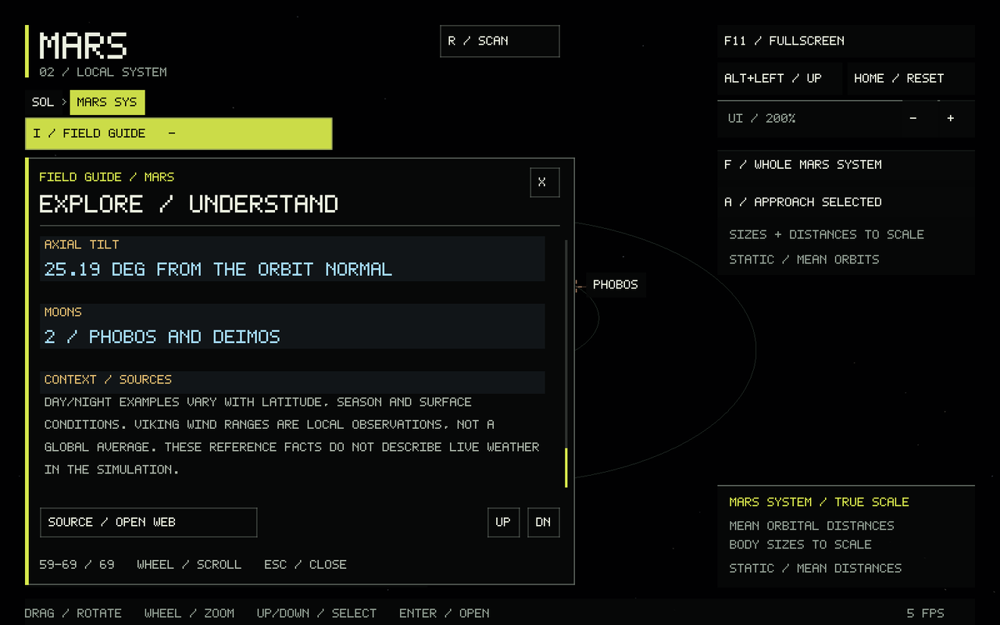

# Field Guide, archive scans and system previews

The shared native **Field Guide** overlay covers all supported bodies and their
location notes in solar, system and globe views. The guide has a wider reading
column, larger body text and section headings, warm fact labels, blue fact
values on subtle cards, and quieter source/context notes. Location notes use
larger body text with the same semantic colors. Both panels wrap and scroll
using typed rows so all content remains reachable at 75–200% UI scale.
The UI remains C++/SDL3/OpenGL with no additional font dependency.

Earth's guide focuses on geographic landmarks: Mount Everest, Mariana Trench,
Grand Canyon and Mauna Loa. Each has camera navigation, inline notes and a primary
source link. See [Earth geography and references](EARTH.md#geographic-landmarks).



## Controls

- **I** or **Field Guide** opens/closes the planet dropdown below the left-side
  breadcrumbs. It overlays that sidebar while open. **Esc** closes it before
  exiting fullscreen or quitting. **Tab** hides all overlays.
- Click a globe **Locations** entry or press **1–4** to focus that destination and
  expand its notes directly beneath the list. **About / location** collapses or
  reopens the paragraph; selecting another destination updates and expands it.
  Esc collapses the notes when the planet guide is closed. Moving away from the
  selected location clears its notes. Satellite mode uses its orbit controls
  instead of the location list.
- Wheel over the panel, **PgUp/PgDn**, up/down arrows or its **UP/DN** buttons scroll.
  **Home/End** reach the start/end of the planet guide. Location notes also accept
  the wheel, PgUp/PgDn and UP/DN when scrolling is necessary. The planet guide takes
  keyboard-scroll priority while open. Wheel outside the panels remains globe zoom.
- **Source / Open Web** opens the article's primary source in the default browser
  only when clicked. All text and previews work offline.
- **R / Scan** replays a three-second archive scan on a ready globe or system
  preview. R still retries a failed detailed-data load.

Clicking outside closes the planet dropdown and allows the clicked underlying
control. Both text panels capture their own pointer/wheel events, fit the existing
75-200% UI scale, and clamp their independent scroll positions after resizing.
Camera arrow-key motion is suspended while the planet guide is open. Location
notes shrink into a scrollable panel on short viewports, leaving the elevation
readout and Mars satellite button accessible. The guide contains only planet
information; location browsing uses the existing globe destination list.

Examples, using the already-built app:

```sh
./build/solar_system_sim --start mars --info
./build/solar_system_sim --start mercury --landmark 3 --location-info
./build/solar_system_sim --start system --body mars --scan
```

`--location-info` selects the first destination if no landmark was supplied for
a focused globe; it no longer opens a location tab in the Field Guide. A normal
landmark selection already expands its notes automatically.

## Science definitions and sources

The text is a paraphrased educational reference, not live telemetry. Planetary
cycle is split into **sidereal rotation**, **solar day** and **year**. Inclination
is the planet's orbit relative to the ecliptic, using rounded J2000 elements;
**axial tilt** is measured from the orbit normal. Neither means the user-defined
inclination of the Mars satellite camera.

Temperature examples are explicitly scoped by place and season. Mars's warm-day
and polar-night examples are not a day/night record from the same location; the
Viking 1 diurnal range supplies a local comparison. There is no defensible single
wind speed for all Mars: the panel gives NASA's seasonal and dust-storm ranges at
the Viking sites and labels them as local observations. Mercury's near-vacuum
exosphere has no conventional bulk weather winds; solar wind is a different
physical phenomenon, so the entry is **N/A**, not an invented zero-speed average.

Reference sources checked 2026-09-27:

| Content | Source |
| --- | --- |
| Mercury cycles, mean gravity, J2000 orbit inclination and axial tilt | [NASA/NSSDCA Mercury fact sheet](https://nssdc.gsfc.nasa.gov/planetary/factsheet/mercuryfact.html) |
| Mercury overview, structure, exosphere, temperature extremes and magnetic field | [NASA Mercury facts](https://science.nasa.gov/mercury/facts/) |
| Mars cycles, gravity, composition, Viking temperature/winds and inclinations | [NASA/NSSDCA Mars fact sheet](https://nssdc.gsfc.nasa.gov/planetary/factsheet/marsfact.html) |
| Mars overview, geological history, seasons, moons and crustal magnetism | [NASA Mars facts](https://science.nasa.gov/mars/facts/) |
| Mars equatorial daytime / polar nighttime examples | [NASA/JPL InSight: Mars at a Glance](https://www.jpl.nasa.gov/news/press_kits/insight/landing/facts/mars-at-a-glance/) |
| Olympus Mons morphology | [NASA/JPL/USGS Olympus Mons mosaic](https://www.jpl.nasa.gov/images/pia00300-olympus-mons/) |
| Valles Marineris structure and modification | [NASA NTRS: Geology of the Valles Marineris](https://ntrs.nasa.gov/search.jsp?R=19780027498) |
| Hellas size, depression and later geological modification | [ESA Mars Express: Frost-covered chaos on Mars](https://www.esa.int/Science_Exploration/Space_Science/Mars_Express/Frost-covered_chaos_on_Mars) |
| Elysium plains and InSight site selection | [NASA/JPL InSight landing site](https://www.jpl.nasa.gov/news/press_kits/insight/launch/mission/landing-site/) |
| Caloris impact structure and lava infill | [NASA Caloris Basin](https://science.nasa.gov/resource/mercurys-caloris-basin/) |
| Rembrandt plains and deformation | [NASA: A closer look into Rembrandt basin](https://science.nasa.gov/photojournal/a-closer-look-into-rembrandt-basin/) |
| Rembrandt diameter / landmark coordinates | [IAU/USGS Rembrandt entry](https://planetarynames.wr.usgs.gov/Feature/14563) |
| Rachmaninoff rings, volcanism and low elevation | [NASA: First global topographic model of Mercury](https://www.nasa.gov/missions/first-global-topographic-model-of-mercury/) |
| Beethoven volcanic/impact plains and remaining uncertainty | [NASA: Mapping Beethoven](https://science.nasa.gov/photojournal/mapping-beethoven/) |

Mercury's axial tilt uses the quantitative fact sheet's **0.034 degrees**, rather
than the rounded/inconsistent prose on the general overview. Gravity entries are
**mean surface gravity** from the sheets, not equatorial effective acceleration.
The Elysium marker represents the wider plains, not InSight's landing point.
Rachmaninoff's marker is a navigation anchor, not a claim to identify the single
deepest DEM pixel. Full topography provenance remains in [DATA.md](DATA.md) and
[MERCURY.md](MERCURY.md).

## Scan presentation

First entry now reads **Scanning / Mars** or **Scanning / Mercury**, with real
worker stages: reading archived elevations, resolving surface relief and assembling
the globe. A latitude sweep reveals one-kilometre elevation contours and a fine
geographic grid on the planet. Loading uses the bundled coarse terrain; completion
switches to the detailed mesh and fades the effect for 0.7 seconds. Controls become
available immediately when data is ready; the fade does not delay interaction.

The animated sweep is an instrument-style visualization of archived data. It is
not a simulated spacecraft sensor or a new observation. No invented completion
percentage, random delay or fake network transfer is displayed. R replays only the
visualization, without rereading the file, rebuilding terrain, changing elevations
or disturbing the saved view. Navigation resets the sweep for the new view. Data
errors remain actionable and support retry/return navigation.

## Small models in planetary-system views

`assets/mars.preview` and `assets/mercury.preview` are bundled **256 x 128**
cell-centred metre grids sampled from the project's verified MOLA16 and MDIS64
files. They contain no image textures or invented surface features. Each produces
**65,536 triangles**, about **1.25 MiB** in vertex/index buffers. The two text files
total approximately 458 KiB. They load without opening either full dataset, and
CMake copies `assets/` beside the executable, including Windows Release builds.

Local-system central bodies for Mars and Mercury use display radius 0.24 (previously
0.15), preserving clearance to the schematic moon lanes. Both use 10x relief and
height tints; Mars also uses the existing illustrative cap coloring. Sizes and
distances remain explicitly schematic. The solar-system overview retains its small
shared sphere. The full focused globes retain their existing detail, sampling,
readouts and controls. The preview is never used as a scientific probe source.

A missing or invalid preview falls back to the previous placeholder sphere;
full-data loading and navigation still work. Text preview format:

```text
SOLAR_PREVIEW 1 MARS 256 128 3396000
<32768 finite metre samples, north-to-south rows, east-positive columns>
```

Mercury uses `MERCURY` and radius `2439400`. The loader validates identity, version,
dimensions, datum, sample count/range and trailing content. Heights are rounded to
0.1 metre for these visual previews; this does not imply source accuracy.

Reproduce them into new output filenames (the tool refuses overwrites):

```sh
cmake --build build --target preview_generate
./build/preview_generate mars data/mars16.mola build/mars.preview
./build/preview_generate mercury data/mercury64.dem build/mercury.preview
```

The data-only CMake configuration also builds this tool without SDL.

## Code and checks

- `guide.*`: sourced articles, wrapping, scrolling and selection state.
- `renderer_guide.cpp` / `ui.hpp`: custom dropdown drawing and hit areas.
- `preview.*` / `tools/preview_generate.cpp`: small source-derived visual assets.
- `scan.hpp`, terrain shader and loader phases: sweep/fade and truthful stage text.
- `main.cpp`, `renderer_navigation.cpp`: input routing, local previews and integration.

```sh
ctest --test-dir build --output-on-failure
```

Manual verification:

1. Select Mars/Mercury in the solar overview; open I and read both planet pages.
2. Scroll to the last fact at 75%, 100% and 200% UI scale; resize the window.
3. Select all four globe locations; verify that the correct paragraph expands
   beneath the list. Collapse it, select another, and check that it reopens.
4. Esc closes the guide before fullscreen/app exit. Tab hides it without invisible
   pointer capture. Wheel over either text panel must not zoom the globe.
5. Enter each detailed globe from a fresh launch; observe the moving contours and
   archive stage text. R replays the effect without another load.
6. Return to each system; check the relief preview, selectable moons and preserved
   camera. Neither full data file should load merely to show its system preview.
7. Try missing full data; the guide and preview remain usable, with retry and Up.
8. Open the guide in Mars satellite mode; close it and verify all orbit controls.

## Jupiter extension

Jupiter uses the same left planet guide and inline region notes, with atmospheric
reference facts instead of surface conditions. Its four region anchors are visual
locations in a stylized looping atmosphere, not fixed surface landmarks. The
guide identifies the Hubble cloud map and Juno imagery used for visual inspiration;
added fine structures and polar fill are illustrative.
[Sources, interpretation and controls](JUPITER.md).

## Moon extension

The Moon now has a two-paragraph field guide and reference facts, plus 16 inline
location articles. All six Apollo landing sites use LROC's 2016 module positions.
Ten natural destinations cover craters, maria, a swirl, multi-ring and far-side
basins, and the south pole. Four compact pages replace a long scrolling sidebar:
comma/period or arrows change page; 1–4 selects the visible row. Location notes
remain under the selection; body facts stay in the left field-guide overlay.
The Moon's fact and coordinate sources are listed in [MOON.md](MOON.md).
