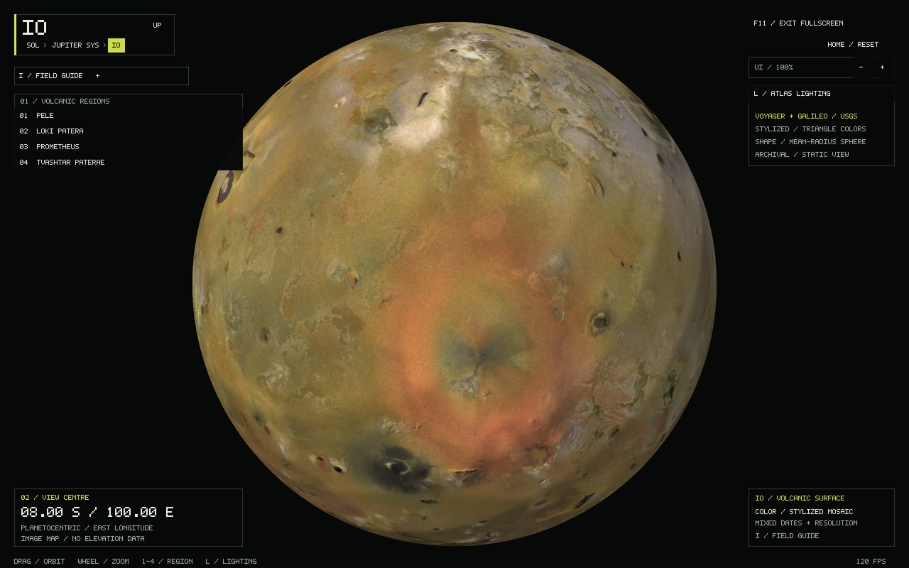
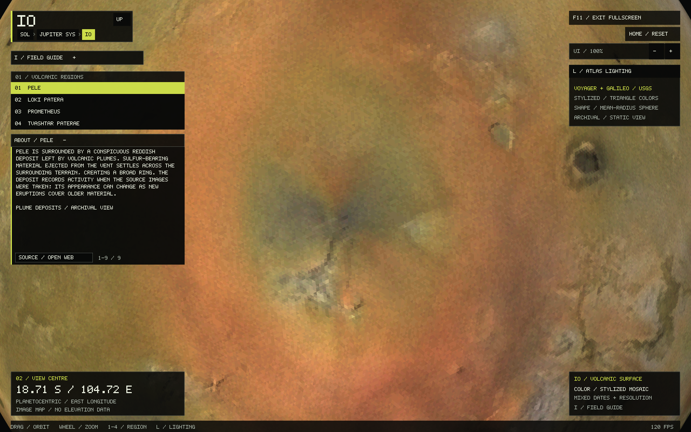

# Io: volcanic surface atlas

Open **Jupiter → Io**, or run:

```sh
./build/solar_system_sim --start io
./build/solar_system_sim --start globe --body io --landmark 1
./build/solar_system_sim --start io --io-unlit --info
```

| Control | Action |
| --- | --- |
| Drag / arrows | Rotate the globe |
| Wheel / + / − | Zoom |
| 1–4 / region buttons | Pele, Loki Patera, Prometheus, Tvashtar Paterae |
| L / lighting button | Stepped atlas lighting or unlit facet colors |
| Home | Reset camera |
| I | Field guide |
| R | Retry after a missing/corrupt map error |
| Alt+Left / Up / breadcrumbs | Return to Jupiter's system |

Generic `--lat`, `--lon`, `--distance`, `--landmark`, `--ui-scale`, `--frames`
and screenshot options work. Camera, selected region and lighting survive
navigation. Selecting a region opens its notes below the list. The guide and
notes scroll independently. The app works offline with the bundled asset.





## Map and interpretation

The source is the USGS
[Io Galileo SSI / Voyager Color Merged Global Mosaic 1km](https://astrogeology.usgs.gov/search/map/io_galileo_ssi_voyager_color_merged_global_mosaic_1km),
credited to NASA/JPL/USGS. It combines Galileo color with finer monochrome
Voyager/Galileo imagery. The red and blue channels incorporate near-infrared
and violet information; this is enhanced composite color. Observations have
different dates and resolutions, and Io changed between them. The source
interpolates polar color where observations are absent. Seams, resolution
differences and those interpolated areas are retained.

The 11,445 × 5,723 GeoTIFF is downsampled with a Lanczos filter to 4,096 × 2,048
RGB8: about 2.8 km per displayed equatorial pixel. Downsampling does not make
the underlying observations uniformly detailed. This app adds no surface
features, lava glow, plumes, temperature map or elevation measurements.

The renderer uses **1,310,720 flat-shaded geodesic triangles** on a mean-radius
sphere. Eight subdivisions of an icosahedron give uniformly shaped triangles,
including at the poles. Each face samples the mosaic at its spherical centroid,
with a fixed ±5% value variation and 5-bit color channels for a DS-inspired
appearance. Crisp face colors replace smooth texture filtering. Lighting uses
the same stepped diffuse response as Mars/Mercury, with no glossy highlights.
This is atlas lighting, not the Sun's position. L removes lighting while retaining
the triangle palette. Geometry remains spherical; styling adds no terrain heights.
The map loads on first entering Io or Jupiter's local system and is cached for
both views. Packed face vertices use 60 MiB of GPU memory; CPU image/mesh staging
is released after upload, and no appearance texture remains on the GPU.
An error leaves navigation available; restore the asset and press R in Io's
globe. The terminal gives the failing path/reason.

## Coordinates and Jupiter integration

The GeoTIFF's raster runs north to south and from −180° to +180° east,
with zero longitude in the middle. USGS catalogue metadata also lists
west-positive coordinates; this does **not** require mirroring the raster.
Pele's red deposits and Loki's dark floor/bright island independently verify
registration. The GeoTIFF uses a 1,821,460-metre projection sphere, 1,000-metre
pixels, and an upper-left corner of (−5,723,000, +2,862,000) metres. Resizing the
whole raster to 2:1 introduces less than one original pixel of edge registration
difference from exact angular bounds.

The app reports planetocentric latitude and east-positive longitude on its
display sphere. The [USGS Gazetteer](https://planetarynames.wr.usgs.gov/SearchResults?Target=21_Io)
supplies approximate regional anchors; its west longitudes are converted as
`east = 360 − west`. These are viewing positions, not surveyed landing targets.

| Region | Latitude | East longitude |
| --- | ---: | ---: |
| Pele | −18.71° | 104.72° |
| Loki Patera | +13.01° | 51.21° |
| Prometheus | −1.52° | 206.06° |
| Tvashtar Paterae | +62.76° | 236.47° |

Io retains the existing [Jupiter-system physical scale](JUPITER.md): a
1,821.49-km mean radius and 421,800-km representative orbital radius, from
JPL's [physical parameters](https://ssd.jpl.nasa.gov/sats/phys_par/) and
[mean elements](https://ssd.jpl.nasa.gov/sats/elem/). Its zero-longitude face is
oriented toward Jupiter in the static layout. Orbital motion, libration and
eclipses are outside this implementation. Io can be tiny at whole-system scale;
the sidebar and label remain easy to select. Its detailed globe has an
independent camera, and returning restores Jupiter-system framing and selection.

## Rebuild the asset

Python 3 and ImageMagick are needed only for offline preparation:

```sh
mkdir -p data/source/io
curl --fail --location --output data/source/io/Io_GalileoSSI-Voyager_Global_Mosaic_ClrMerge_1km.tif \
  https://planetarymaps.usgs.gov/mosaic/Io_GalileoSSI-Voyager_Global_Mosaic_ClrMerge_1km.tif
python3 tools/prepare_io.py \
  data/source/io/Io_GalileoSSI-Voyager_Global_Mosaic_ClrMerge_1km.tif \
  data/source/io/io-prepared.rgb
```

The converter refuses an existing output or a different source SHA-256:
`135f88cb645bfdb4e045b380971ab2ba14e230590c96c9c86cfe7310fda881ac`.
After checking the regenerated file, copy it to `assets/io-voyager-galileo.rgb`
and rebuild. CMake packages the asset beside the executable.

The header is `IO_RGB 1 4096 2048 d9dbc74f4f0aa1db\n`, followed by exactly
25,165,824 RGB8 bytes. The final token is a 64-bit FNV-1a payload checksum.
Runtime loading checks the magic, version, dimensions, checksum and exact length.
No runtime image-decoding library or network request is required.

## Field-guide references

- [NASA Io facts](https://science.nasa.gov/jupiter/jupiter-moons/io/facts/):
  volcanism, tidal heating, synchronous rotation and the thin atmosphere.
- [Pele plume deposit](https://science.nasa.gov/photojournal/pele-plume-deposit-on-io/).
- [USGS: lava lakes beyond Earth](https://www.usgs.gov/observatories/hvo/news/volcano-watch-active-lava-lakes-are-found-beyond-earth): Loki Patera.
- [Galileo close-up of Prometheus](https://science.nasa.gov/photojournal/galileo-takes-a-close-up-look-at-prometheus/).
- [Tvashtar in Motion](https://science.nasa.gov/photojournal/tvashtar-in-motion/):
  New Horizons' later 2007 plume observations, not part of the displayed map.

## Verification

`io_tests` covers source registration, triangle winding, sphere radii, flat
5-bit face colors, corrupt/missing/truncated file rejection,
camera/lighting/region controls, scaled HUD hit areas and notes, guide wrapping,
and round trips to Jupiter with retained system framing and selection.

The Release build and all 11 CTest suites passed. Native OpenGL checks covered
all four destinations, both lighting modes, guide scrolling, 200% UI scale,
both poles, the longitude seam at maximum zoom, and navigation through Jupiter
and the solar system. A settled Io → Jupiter → Io round trip produced identical
pixels outside the FPS footer. Missing and corrupt maps were checked in an
isolated fixture; restoring the map and pressing R recovered the globe without
changing its camera, and subsequent retries kept the cached geometry.

```sh
ctest --test-dir build --output-on-failure
./build/solar_system_sim --start io --fullscreen --frames 30 --screenshot build/io.ppm
./build/solar_system_sim --start io --landmark 2 --ui-scale 2 --frames 30
./build/solar_system_sim --start io --lat 90 --frames 30
./build/solar_system_sim --start io --lon 180 --distance 1.18 --frames 30
```
