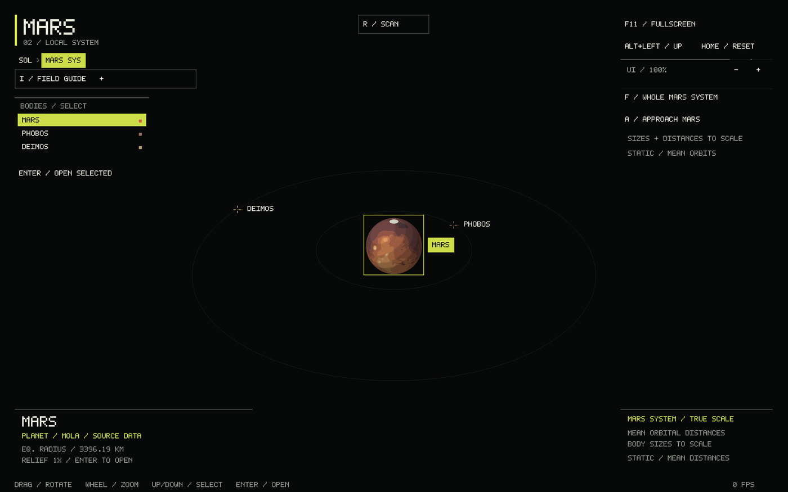

# Physical Mars system proportions

The Mars system now uses **10,000 km per scene unit** for both body dimensions
and centre-to-centre orbital distances. Mars has a 3,396.19 km equatorial
reference radius, matching the [NASA Mars fact sheet](https://nssdc.gsfc.nasa.gov/planetary/factsheet/marsfact.html). Its MOLA terrain preview is displayed at 1× relief in this
system; the independent globe keeps its relief setting and its existing MOLA
reference datum. The system retains the project's spherical Mars approximation.

[JPL satellite physical parameters](https://ssd.jpl.nasa.gov/sats/phys_par/sep.html)
supply the volume-equivalent mean radii. The
[JPL mean orbital elements](https://ssd.jpl.nasa.gov/sats/elem/sep.html)
supply representative MAR099 semimajor axes:

| Body | Reference radius, km | Orbit from Mars's centre, km |
|---|---:|---:|
| Mars | 3,396.19 equatorial | — |
| Phobos | 11.08 mean | 9,375 |
| Deimos | 6.20 mean | 23,457 |

Phobos and Deimos retain their checked NASA irregular models. Each model is
scaled uniformly so its signed mesh volume has the listed equivalent spherical
radius. Its maximum radius divided by equivalent radius is 1.2456285520088957
for Phobos and 1.3455977654939208 for Deimos. Selection uses that bounding radius;
it does not inflate rendered geometry. Shape and source accuracy limits remain
as described in [SATELLITES.md](SATELLITES.md).

At this scale the moons can be smaller than a pixel. Labeled locator crosses and
the body list keep them selectable. **F / Whole system** frames both orbits;
**A / Approach selected** moves to the selected planet or moon and fits its physical size. Drag, wheel and Home work as before.
The saved system camera and selected moon survive visits to individual globes.

```sh
./build/solar_system_sim --start system --body mars
```

Orbit guides remain static coplanar circles at mean distances, with representative
angular placements. They are not instantaneous positions, measured inclinations,
or an ephemeris simulation. The HUD states these limits. The accurate change is
the shared size/distance scale, rather than a claim of current orbital state.

Tests check the radii, shared distance scale, orbit ratios, locator selection,
whole/approach framing, zoom bounds, return-state restoration and volume-based
model calibration. Native OpenGL inspection confirms 1× Mars terrain, tiny
irregular moon bodies and usable labels.


