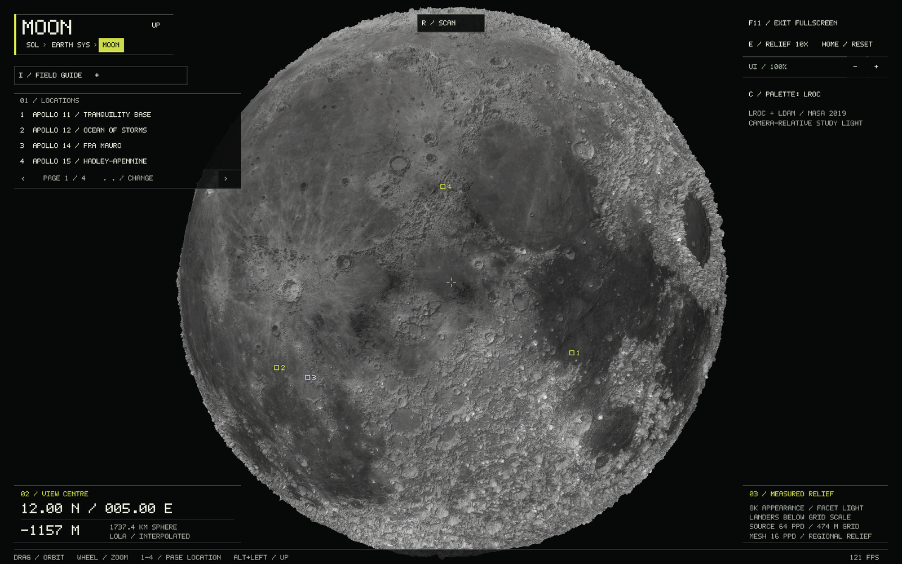

# Moon / LOLA atlas

The Moon is a detailed globe reachable through Solar system → Earth → Moon.
The Earth system also has a small, source-derived lunar relief preview. The local
Earth layout remains explicitly schematic; this change does not add orbital
simulation, new Earth terrain, or lunar surface vehicles.

## Run and controls

The executable and data are already prepared on this machine:

~~~sh
cd /home/schady/Projects/solar_system_sim
./build/solar_system_sim --start moon --fullscreen
./build/solar_system_sim --start moon --landmark 1 --location-info
~~~

Drag/arrows orbit; wheel/+/- zoom. Home returns to the near-side overview.
Comma/period or the page arrows browse four pages of four destinations.
1–4 selects a row on the current page; --landmark 1..16 selects an absolute index
at launch. Selection expands the corresponding notes beneath the list.
I opens the body field guide. C switches LROC appearance/elevation colors;
E toggles 10×/1× relief; R replays the archive scan. The scan is a visualization
of already archived data, not a live instrument. F11 changes fullscreen,
[ / ] changes UI scale, and Alt+Left returns to Earth's system.
Camera, page, destination, palette and relief survive leaving and returning.

## Exact elevation source

NASA PDS Geosciences Node, LRO/LOLA GDR, **LDEM_64, V3.1**, product creation
2019-03-15, observations 2009-07-13 through 2016-11-29:

- [ldem_64.img](https://pds-geosciences.wustl.edu/lro/lro-l-lola-3-rdr-v1/lrolol_1xxx/data/lola_gdr/cylindrical/img/ldem_64.img)
- [ldem_64.lbl](https://pds-geosciences.wustl.edu/lro/lro-l-lola-3-rdr-v1/lrolol_1xxx/data/lola_gdr/cylindrical/img/ldem_64.lbl), preserved in this repository at [moon/ldem_64.lbl](moon/ldem_64.lbl)
- [LOLA RDR/GDR Software Interface Specification](https://pds-geosciences.wustl.edu/lro/lro-l-lola-3-rdr-v1/lrolol_1xxx/document/rdrsis.htm)
- [PDS LOLA data FAQ](https://pds-geosciences.wustl.edu/missions/lro/lola_faq.htm)

The converter verifies the accompanying label before interpreting the image.
Its relevant fields are:

| Property | Label value / interpretation |
| --- | --- |
| Dataset | LRO-L-LOLA-4-GDR-V1.0 |
| Dimensions | 23040 samples × 11520 lines, global 64 pixels/degree |
| Records | 11520 × 46080 bytes; exactly 530841600 image bytes |
| Samples | LSB_INTEGER, signed 16-bit little endian; no image header |
| Scaling | 0.5 m per DN |
| Reference sphere / OFFSET | 1737400 m |
| Elevation | **DN × 0.5 m**, without adding OFFSET |
| Planetary radius | 1737400 m + DN × 0.5 m |
| Label extrema | DN −18251..21546, or height −9125.5..10773 m |
| Missing values | No missing/invalid constant is declared in this product |
| Projection | Simple cylindrical; east-positive 0..360° |
| Frame | Body-fixed, mean Earth/polar axis of DE421; not the PA product |
| Registration | Pixel centres; projection offsets 5759.5 and 11519.5 pixels |
| Grid scale | 473.802 m/pixel at equator |

Out-of-range samples, unexpected special-value declarations, wrong dimensions,
byte order, frame, scaling and padding are rejected. These are heights relative
to a sphere, **not lunar geoid/sea-level heights**. The app's prepared MOONDEM1
format preserves every signed half-metre sample in little-endian order with a
32-byte versioned header and FNV-1a payload checksum.

Source SHA-256 values:

~~~
ldem_64.lbl  4e7a94c76c716a147b21ccf07669d004246b0d1b017b7d63d50befaa1a34142d
ldem_64.img  1c4958699d4cffd7e777d51421b6044bba300aa0bef286a544309efb082cdbd6
moon64.dem  80485d24bc85a38ab530b49224e291b0037541ffc9d133e895847d002f597e6e
~~~

## Appearance, coordinates and geometry

Appearance is separate from elevation: the [NASA SVS CGI Moon Kit](https://svs.gsfc.nasa.gov/4720)
2019 [lroc_color_poles_8k.tif](https://svs.gsfc.nasa.gov/vis/a000000/a004700/a004720/lroc_color_poles_8k.tif),
8192 × 4096 RGB. Credit NASA/GSFC/Arizona State University; visualization Ernie
Wright. NASA adapted the LROC WAC mosaic for rendering, adjusting exposure and
color; beyond ±70°, lower-resolution LOLA albedo fills the missing camera
coverage. This is a display map, not a scientific color measurement. The app
reduces saturation and quantizes brightness modestly for its restrained palette.

SHA-256 of that TIFF:
4af8b0cd4d50c30851359d98e7e72040240dd8d03256b58b345b5b76e9edb4ef.
Prepared moon2019.rgb:
a061015ca604deb16bdcf49bd32a93f84cdea623131f5949d9b83a8ca0da7771.
The checked RGB payload is 100663296 bytes; no image decoder is needed at runtime.
An absent or corrupt appearance map falls back to labeled uniform gray, keeping
the measured terrain usable.

The existing right-handed globe uses +Y north, +X at 0°E, and −Z at 90°E.
For latitude φ and east longitude λ:

~~~text
direction = (cos φ cos λ, sin φ, -cos φ sin λ)
position  = direction × (1 + height_m × exaggeration / 1737400)
~~~

Elevation samples start just east of 0°, just south of 90°N. The sampler uses
x = wrapped_longitude × 64 − 0.5 and y = (90 − latitude) × 64 − 0.5.
Bilinear interpolation wraps longitude; the last half-cell at either pole
converges to the terminal row's mean. The appearance map is instead centred on
0° longitude: u = longitude/360 + 0.5, v = 0.5 − latitude/180.
This distinction prevents a 180° mismatch between craters and their relief.

Default mesh spacing is 16 samples/degree (~1.895 km at the equator), the same
33,177,600-triangle budget as the detailed Mars/Mercury meshes. --moon-detail 8
or 4 reduces geometry to 8,294,400 or 2,073,600 triangles without changing
64 ppd readouts. The indexed globe shares seam vertices and one vertex per pole.
There are no mixed terrain levels and thus no LOD cracks. Existing conservative
batch culling uses the Moon's radius and minimum elevation, not Mars's.

Relief defaults to **10×** for readability. Elevation probes always report the
unexaggerated grid interpolation. The camera stays outside the maximum raised
terrain with near-plane clearance. Faceted lighting follows the camera; two
small 512 × 512 polar gradient maps, computed from the same elevation grid,
stabilize the lighting of very thin triangles. Their finite differences use the
16 ppd mesh spacing and respond correctly to 1×/10× relief. Only shading blends
toward these slopes between 75° and 87° latitude; geometry and probes are unchanged.
This is not illumination
for a real date, a shadow model, or an ice-distribution map.

LOLA grid spacing is not a promise of feature resolution. Interpolation between
tracks and the coarser rendering mesh limit close-up detail. The source label
also warns of possible artifacts at 45° latitude-band boundaries. Individual
landers, tracks, footprints, boulders and narrow rilles are not modeled.
More zoom cannot create evidence absent from the source.

## Destinations and provenance

Apollo module coordinates are from the LROC Science Operations Team's
[Coordinates of Lunar Anthropogenic Targets, 28 July 2016](https://www.lroc.asu.edu/data/support/downloads/2016_LROC_Coordinates_of_Human_Features.pdf),
in the mean Earth/polar-axis frame. Natural-feature centres use the linked
IAU/USGS Gazetteer records, rounded regional anchors (east longitudes normalized
to 0..360°). They are not surveyed spacecraft positions.

| Index | Destination | Latitude | Longitude °E | Coordinate reference |
| --- | --- | ---: | ---: | --- |
| 1 | Apollo 11 / Tranquility Base | 0.67416 | 23.47314 | LROC 2016 LM |
| 2 | Apollo 12 / Ocean of Storms | −3.0128 | 336.5781 | LROC 2016 LM |
| 3 | Apollo 14 / Fra Mauro | −3.64589 | 342.52806 | LROC 2016 LM |
| 4 | Apollo 15 / Hadley-Apennine | 26.13239 | 3.63330 | LROC 2016 LM |
| 5 | Apollo 16 / Descartes | −8.9734 | 15.5011 | LROC 2016 LM |
| 6 | Apollo 17 / Taurus-Littrow | 20.1911 | 30.7723 | LROC 2016 LM |
| 7 | Tycho | −43.30 | 348.78 | [6163](https://planetarynames.wr.usgs.gov/Feature/6163) |
| 8 | Copernicus | 9.62 | 339.92 | [1296](https://planetarynames.wr.usgs.gov/Feature/1296) |
| 9 | Aristarchus | 23.73 | 312.51 | [380](https://planetarynames.wr.usgs.gov/Feature/380) |
| 10 | Plato | 51.62 | 350.62 | [4757](https://planetarynames.wr.usgs.gov/Feature/4757) |
| 11 | Mare Imbrium | 34.72 | 345.09 | [3678](https://planetarynames.wr.usgs.gov/Feature/3678) |
| 12 | Reiner Gamma | 7.39 | 301.04 | [4987](https://planetarynames.wr.usgs.gov/Feature/4987) |
| 13 | Orientale (mare centre) | −19.87 | 265.33 | [3685](https://planetarynames.wr.usgs.gov/Feature/3685) |
| 14 | Tsiolkovskiy | −20.38 | 128.97 | [6108](https://planetarynames.wr.usgs.gov/Feature/6108) |
| 15 | South Pole–Aitken | ~−53 | ~191 | [USGS basin mapping study](https://www.hou.usra.edu/meetings/pgm2021/pdf/7032.pdf) |
| 16 | Shackleton | −89.63 | 132.32 | [5450, published LOLA centre](https://planetarynames.wr.usgs.gov/Feature/5450) |

Each location has a short paragraph and a source button. Apollo narratives link
to NASA's individual mission pages. The other articles link to NASA crater
studies, USGS descriptions, or SVS's lunar-swirl explanation. Body facts use
[NASA Moon Facts](https://science.nasa.gov/moon/facts/) and the
[NASA Moon Fact Sheet](https://nssdc.gsfc.nasa.gov/planetary/factsheet/moonfact.html).
The app reports orbital inclination relative to the ecliptic and axial tilt
relative to the lunar orbital plane; these are different reference planes.

## Reproduce the data and build

SDL3 and the platform OpenGL driver remain the only runtime requirements.
Use the existing Linux/Windows SDL3 setup in the main README.

~~~sh
cmake -S . -B build -DCMAKE_BUILD_TYPE=Release
cmake --build build -j
bash tools/download_moon.sh
build/moon_convert data/source/moon/ldem_64.lbl data/source/moon/ldem_64.img data/moon64.dem
ctest --test-dir build --output-on-failure
build/solar_system_sim --start moon
~~~

Windows PowerShell equivalents:

~~~powershell
cmake --build build --config Release
./tools/download_moon.ps1
./build/Release/moon_convert.exe data/source/moon/ldem_64.lbl data/source/moon/ldem_64.img data/moon64.dem
ctest --test-dir build -C Release --output-on-failure
./build/Release/solar_system_sim.exe --start moon
~~~

The downloader checks pinned SHA-256 hashes, downloads to .part files and
reuses verified source files. The converter refuses to overwrite existing output.
The source IMG is ~506 MiB; the prepared grid occupies another ~506 MiB.
The initial app performs no downloads. --moon-data overrides the prepared path.

The small relief preview and prepared 8K appearance asset are bundled. To
regenerate them, use a **new output filename**:

~~~sh
build/preview_generate moon data/moon64.dem build/moon-new.preview
curl --fail --location https://svs.gsfc.nasa.gov/vis/a000000/a004700/a004720/lroc_color_poles_8k.tif -o data/source/moon/lroc_color_poles_8k.tif
python3 tools/prepare_moon_color.py data/source/moon/lroc_color_poles_8k.tif build/moon-new.rgb
~~~

Only regenerating the appearance asset needs Python 3 and ImageMagick, following
the existing Jupiter asset workflow. Neither is a runtime or normal build
dependency. The source TIFF's pinned hash is verified before conversion.
The normal CMake build copies bundled assets beside the executable.

## Verification

- Moon tests cover label variants, signed scaling, datum, pixel centres,
  interpolation, longitude wrapping, shared seam/poles, invalid DN rejection,
  file size/header/checksum rejection, camera clearance and Moon → Earth → Moon.
- Guide tests cover every lunar article and location bounds, wrapping and the
  compact paged layout.
- Optional real-data check:
  build/moon_tests docs/moon/ldem_64.lbl data/moon64.dem.
  Apollo sample expectations were independently decoded from the raw IMG.
- Manual: open Earth → Moon; visit all four destination pages; check Apollo 11,
  Tycho, Orientale, the far side and Shackleton. Toggle C/E; confirm E does not
  change the scientific height at a fixed coordinate. Use R and I, scroll notes,
  test 200% UI, and return to Earth then re-enter Moon with the prior view intact.
- No Windows runtime verification was performed on this Linux machine.
