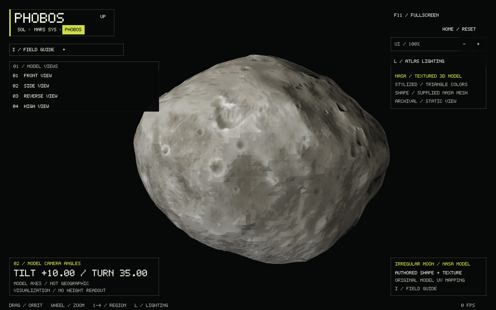
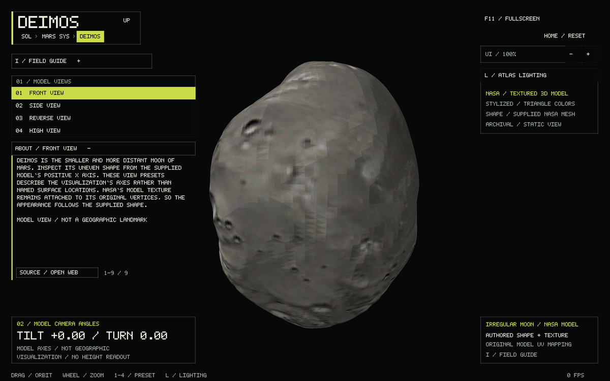
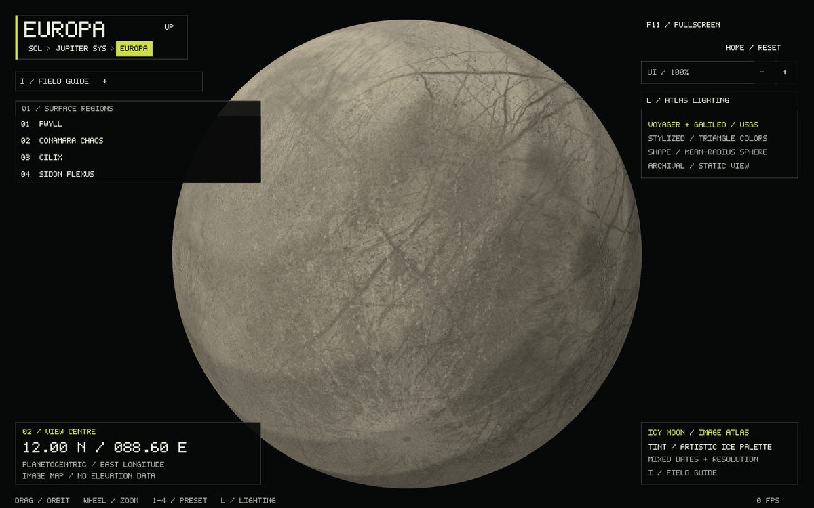
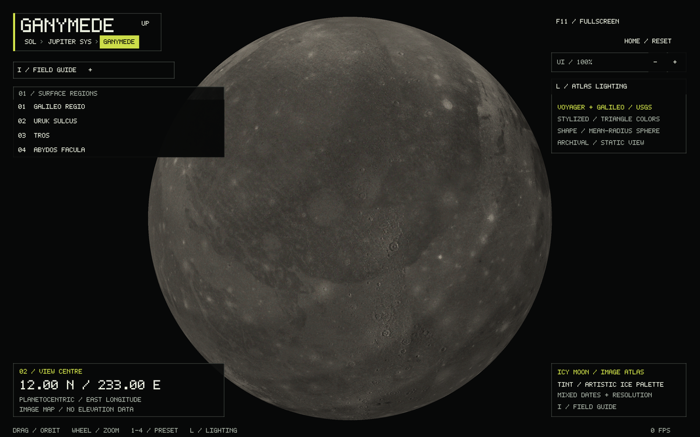

# Phobos, Deimos, Europa and Ganymede

All four former placeholders now have dedicated explorers, independent session
camera state, four destinations, lighting controls, field guides, location notes,
checked assets and detailed models in their parent system. This completes the
four Galilean moons already included in the catalog; it does not add Jupiter's
small inner or irregular satellites.

```sh
./build/solar_system_sim --start phobos
./build/solar_system_sim --start deimos --location-info
./build/solar_system_sim --start europa --landmark 1
./build/solar_system_sim --start ganymede --landmark 2
```

The existing `--start globe --body NAME` also works. Drag or arrow keys rotate,
wheel or +/− zoom, Home resets, 1–4 selects a destination, L switches between
stepped atlas lighting and unlit colors, I opens the guide, and Alt+Left or the Up
button returns to the parent system. `--lat`, `--lon`, `--distance`, `--landmark`,
`--info`, `--location-info`, `--frames` and `--screenshot` apply to these explorers.
R retries a missing or invalid asset. Failed loads retain navigation, controls
and a visibly labeled fallback; they do not terminate the application.

## Shape and coordinate limits

**Phobos and Deimos** preserve NASA/JPL-Caltech's supplied textured GLB geometry
and UV islands. Two planar subdivisions per original triangle refine the color
sampling without changing the surface. Each triangle receives one texture color,
quantized to the existing 5-bit palette. The complete model is scaled uniformly
by its maximum vertex distance from the original origin: relative dimensions,
crater geometry, axes and texture alignment are retained. There are 512,640
Phobos triangles and 520,192 Deimos triangles. No sphere deformation, invented
craters or synthetic elevation field is added.

NASA provides these as visualization assets, without a surveyed coordinate-frame
or elevation-accuracy specification on the download pages. Their readouts are
therefore **model camera tilt/turn**, not geographic latitude/east longitude.
Their four destinations are model front, side, reverse and high views, not
unverified crater-centre coordinates. `--lat` and `--lon` set those model camera
angles. Texture illumination is baked into the original images; unlit mode
removes only the renderer's additional lighting. Mars's local layout now uses physical sizes and mean orbital distances, with
model volumes calibrated to the moons' mean radii; see [MARS_SYSTEM.md](MARS_SYSTEM.md). These meshes use
bounding spheres for system selection, and have no terrain-height readout.

**Europa and Ganymede** use USGS Voyager/Galileo monochrome mosaics, each prepared
at 4096 × 2048 and displayed on a mean-radius sphere with 1,310,720 uniform
geodesic triangles. The warm ice/stone palette is artistic, not observed color or
composition. Source coverage, resolution, observing dates and illumination vary;
zero-valued missing coverage remains flat charcoal. There is no global DEM or
measured relief. Jupiter's physical body sizes and mean orbital spacing remain
as described in [JUPITER.md](JUPITER.md).

Both GeoTIFFs have Simple Cylindrical projection, centre longitude 180° E,
positive projected X to the right, and north at the top. Thus their raster runs
0–360° E. Preparation shifts half a row to the renderer's −180–180° E convention;
it **does not mirror** the west-positive feature-label coordinates. The atlas
uses planetocentric latitude; the spherical approximation makes the Gazetteer's
planetographic regional anchors equivalent for this display.

| Europa destination | Latitude | East longitude | Ganymede destination | Latitude | East longitude |
|---|---:|---:|---|---:|---:|
| Pwyll | −25.20° | 88.60° | Galileo Regio | 45.00° | 233.00° |
| Conamara Chaos | 9.70° | 87.30° | Uruk Sulcus | 3.40° | 200.00° |
| Cilix | 2.60° | 178.10° | Tros | 11.14° | 332.74° |
| Sidon Flexus | −66.40° | 176.60° | Abydos Facula | 33.33° | 206.56° |

Anchors come from the USGS Gazetteer: [Europa](https://planetarynames.wr.usgs.gov/SearchResults?Target=22_Europa)
and [Ganymede](https://planetarynames.wr.usgs.gov/SearchResults?Target=23_Ganymede),
converting west longitude W to east longitude `(360 − W) mod 360`. Broad features
are regional anchors, not exact boundaries.

## Pinned sources and reproduction

Credit for Phobos and Deimos: **NASA/JPL-Caltech**.

- [Phobos model page](https://science.nasa.gov/resource/phobos-mars-moon-3d-model/):
  [24878_Phobos_1_1000.glb](https://assets.science.nasa.gov/content/dam/science/psd/mars/resources/gltf_files/24878_Phobos_1_1000.glb).
  SHA256 `757712101e4fbcf9527942ee664a3bc6dfe3ab460466b760f4bf51ee85dbd8d3`.
- [Deimos model page](https://science.nasa.gov/resource/deimos-mars-moon-3d-model/):
  [24879_Deimos_1_1000.glb](https://assets.science.nasa.gov/content/dam/science/psd/mars/resources/gltf_files/24879_Deimos_1_1000.glb).
  SHA256 `5d5da763970acffe88aac26d3c3bd0fa66c5bef251d1bb4bfe2ae5fd723507e4`.

Credit for Europa and Ganymede: **USGS Astrogeology / NASA Voyager and Galileo**.

- [Europa USGS catalog](https://astrogeology.usgs.gov/search/map/europa_voyager_galileo_ssi_global_mosaic_500m):
  [Europa_Voyager_GalileoSSI_global_mosaic_500m.tif](https://planetarymaps.usgs.gov/mosaic/Europa_Voyager_GalileoSSI_global_mosaic_500m.tif),
  19,631 × 9,816, approximately 500 m/pixel at the equator.
  SHA256 `a323f0c9ccb47d5af9902ea8297fe81f9a9708795645b80801f103c3f7c9a624`.
- [Ganymede USGS catalog](https://astrogeology.usgs.gov/search/map/ganymede_voyager_galileo_ssi_global_mosaic_1km):
  [Ganymede_Voyager_GalileoSSI_global_mosaic_1km.tif](https://planetarymaps.usgs.gov/mosaic/Ganymede_Voyager_GalileoSSI_global_mosaic_1km.tif),
  16,539 × 8,270, approximately 1 km/pixel at the equator.
  SHA256 `c2c8d9506b8cf8f7a0a90d823d9052e91c8d9885cf7267fdce8de8216f4df888`.

After downloading those files, run the offline converter (Python standard library
and ImageMagick; no new runtime dependencies):

```sh
python3 tools/prepare_satellites.py phobos /path/to/24878_Phobos_1_1000.glb /tmp/phobos-nasa.mesh
python3 tools/prepare_satellites.py deimos /path/to/24879_Deimos_1_1000.glb /tmp/deimos-nasa.mesh
python3 tools/prepare_satellites.py europa /path/to/Europa_Voyager_GalileoSSI_global_mosaic_500m.tif /tmp/europa-voyager-galileo.rgb
python3 tools/prepare_satellites.py ganymede /path/to/Ganymede_Voyager_GalileoSSI_global_mosaic_1km.tif /tmp/ganymede-voyager-galileo.rgb
```

The converter pins source SHA256, refuses overwrite, and validates the expected
source dimensions/model layout. Ship the four prepared files in `assets` beside
the executable; CMake copies them automatically.

RGB format is the existing checked faceted-map format: one ASCII line
`BODY_RGB 1 4096 2048 FNV1A64` followed by north-to-south RGB8 pixels. Mesh format
is `BODY_MESH 1 VERTEX_COUNT FNV1A64` followed by little-endian records containing
three float32 positions and four RGBA8 bytes. It is explicitly decoded at runtime
rather than relying on host byte order. Counts are bounded before allocation;
identity, version, dimensions/count, exact length, checksum, finite positions,
normalized bounds, winding, opacity and per-face color agreement are checked.

The four assets total about 95 MiB. On first entry to a globe or its parent
system, each relevant asset is loaded and uploaded on the main thread. CPU mesh
storage is released after upload. The two Jovian meshes use about 60 MiB of GPU
geometry each; each Mars moon uses about 24 MiB. The meshes remain cached until
exit and are shared with system previews. First-entry CPU processing can briefly
pause presentation, consistent with the existing Io/Callisto atlas path.

## Review and verification

The review followed the catalog, navigation/transition state, main input dispatch,
UI hit testing, guide routing, checked faceted loaders, GL lifecycle, asset
preparation and existing moon tests. The missing pieces were empty dataset IDs
and generic globe routing for these four bodies. Extending the spherical atlas
alone would also have discarded Phobos/Deimos shape, so the shared satellite
explorer accepts both checked image maps and checked textured meshes.

All 13 CTest targets pass. The satellite test checks the four assets, outward
nondegenerate triangles, flat quantized colors, spherical versus irregular
geometry, corrupt/trailing files, oversized headers, raster-registration samples,
longitude wrapping, missing coverage, controls, guide bounds, responsive UI hit
regions, parent breadcrumbs, selected moon restoration and saved system cameras.
OpenGL launches and screenshots were checked for all four globes and both parent
systems. These checks do not validate the NASA models as surveyed terrain or add
an ephemeris simulation.





