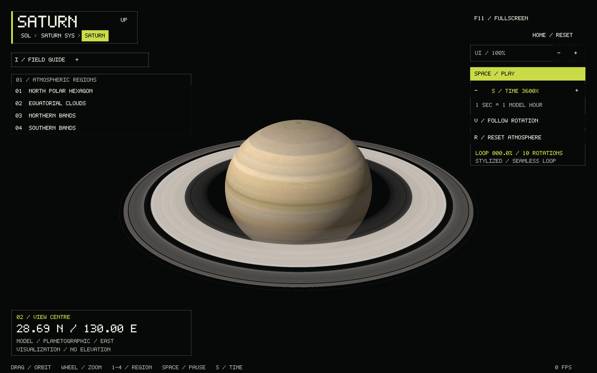
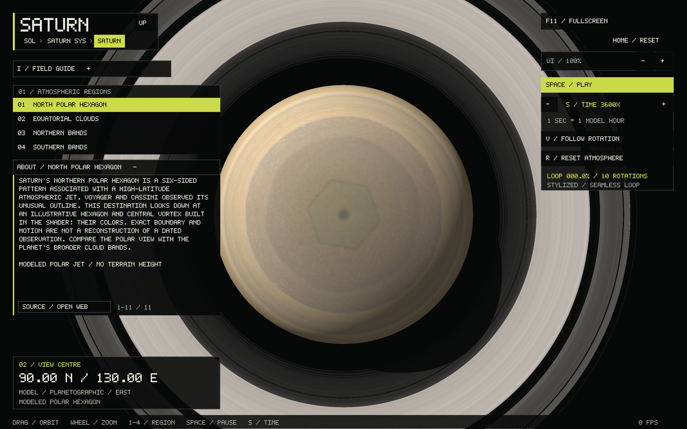

# Saturn explorer

Saturn uses Jupiter's checked-reference atmospheric pipeline with an independent
camera, clock, cloud texture, jet profile and softer golden palette. The globe is
an oblate ellipsoid with 60,268 km equatorial and 54,364 km polar reference radii.
Its transparent, two-sided rings have native radial texture, physical major ring
edges and analytic shadows on the planet and from the planet onto the rings.

```sh
./build/solar_system_sim --start saturn
./build/solar_system_sim --start saturn --landmark 1 --saturn-paused
./build/solar_system_sim --start system --body saturn
```

Drag or arrows rotate, wheel or +/− zoom, Home resets the camera, 1–4 opens a
regional view, I opens the field guide, and Alt+Left returns to the parent system.
Space pauses, S cycles 1×/60×/600×/3600× time, V switches between following the
cloud reference and watching its rotation, and R resets the atmosphere or retries
failed asset loading. Changing reference frames or resetting time preserves the
visible camera pose. Globe and system controls share Saturn's independent clock;
it stops when another system is active or navigation is transitioning.

CLI options: `--saturn-rate 1|60|600|3600`, `--saturn-paused`, `--saturn-low`,
`--saturn-phase 0..360`, and the shared camera, guide and screenshot flags.
Phase describes a complete ten-rotation loop, not a geographic longitude.

## Appearance source and reproduction

Credit: **NASA Visualization Technology Applications and Development (VTAD)**.
The [NASA Saturn 3D visualization](https://science.nasa.gov/resource/saturn-3d-model/)
contains the cloud appearance and radial ring strip:
[Saturn_1_120536.glb](https://assets.science.nasa.gov/content/dam/science/psd/solar/2023/09/s/Saturn_1_120536.glb).
Pinned SHA256: `8dbfde533b13e938408d8aded1d1ce48a084806233f67775371d83013dba7d38`.
This is a visualization asset, without a surveyed atmospheric coordinate epoch.

The offline converter uses Python's standard library and ImageMagick:

```sh
python3 tools/prepare_saturn.py /path/to/Saturn_1_120536.glb /tmp/saturn-vtad.rgb /tmp/saturn-rings.rgba
```

It refuses overwrite and checks the source SHA256 and expected texture sizes.
The 4096 × 3072 source is a cube UV atlas: the converter intersects ellipsoidal
rays with the original textured triangles to produce a 2048 × 1024 cylindrical
map. Destination rows are planetographic latitude, north to south; longitude
uses the source model's axes and the renderer's east-positive convention.
This preserves the source's UV mapping rather than treating the cube atlas as
a rectangular planetary map. Every destination pixel must be covered.

The 4096 × 16 ring image is reduced to a 4096 × 1 radial RGBA strip by averaging
in premultiplied alpha space. Runtime maps the original model's normalized radial
range 1.2323–2.3309 to the annulus. Prepared file headers are:

- `SATURN_RGB 1 2048 1024 FNV1A64`, followed by RGB8 pixels.
- `SATURN_RINGS 1 4096 1 FNV1A64`, followed by RGBA8 pixels.

Identity, version, dimensions, exact payload length and checksum are checked.
CMake copies both assets beside the executable. Missing or invalid assets retain
navigation and a labeled fallback; R retries the reference.

## Physical references and model limits

The [NASA Saturn fact sheet](https://nssdc.gsfc.nasa.gov/planetary/factsheet/saturnfact.html)
supplies the radii and the 10.656-hour System III reference period. The loop is
106.56 model hours, about 106.56 real seconds at the default 3600× rate. Its
periodic noise fields and integer angular harmonics close exactly over this
interval. Differential cloud motion, jet speeds, haze, lighting, vortex colors
and the northern hexagon are authored illustrations, not measured weather or a
reconstruction of a dated Cassini observation. The
[Cassini hexagon reference](https://science.nasa.gov/mission/cassini/science/saturn/hexagon-in-motion/)
provides context for the northern polar region. There is no surface terrain,
DEM or elevation readout. Displayed coordinates describe this model reference.

The [NASA ring fact sheet](https://nssdc.gsfc.nasa.gov/planetary/factsheet/satringfact.html)
supplies representative ring radii, measured from Saturn's centre:

| Boundary | Radius, km |
|---|---:|
| C inner | 74,658 |
| C outer / B inner | 91,975 |
| B outer / Cassini Division inner | 117,507 |
| A inner / Cassini Division outer | 122,340 |
| Encke gap centre | 133,410 |
| A outer | 136,780 |
| F ring centre | 139,826 |

The Encke gap is modeled 320 km wide and the F ring 100 km wide. Ring opacity
intervals are authored for readability; the texture is not measured optical
depth. Fine ringlets are supplied by the source strip, without individual
particle simulation. The sparse D, E and G rings are omitted. The plane has zero
geometric thickness, so it disappears when viewed exactly edge-on. Lighting is
camera-relative atlas lighting, not an astronomical Sun direction.

Saturn's local system now uses physical sizes and mean orbital distances for
[seven major moons](SATURN_MOONS.md), with F/N/A framing controls and detailed
NASA moon explorers. The solar overview uses its physical common scale.

## Verification

Default geometry has 589,824 globe triangles; `--saturn-low` has 65,536.
The ring annulus has 4,096 triangles. Source pixels occupy about 6 MiB plus
16 KiB for the ring strip; the noise volume is 1 MiB. Resources are cached and
released with the renderer, including partial initialization after a failure.

All 15 CTest targets pass. Saturn tests cover loop closure, clock controls,
latitude conversion, ring radii/winding, camera frame preservation, oblate globe
picking, guides, responsive controls and invalid/trailing/corrupt assets. Native
OpenGL renders were inspected from northern, southern, equatorial and polar
views, at both mesh settings and in the system view. Hidden-UI renders at loop
phases 0 and 360 are byte-identical.



