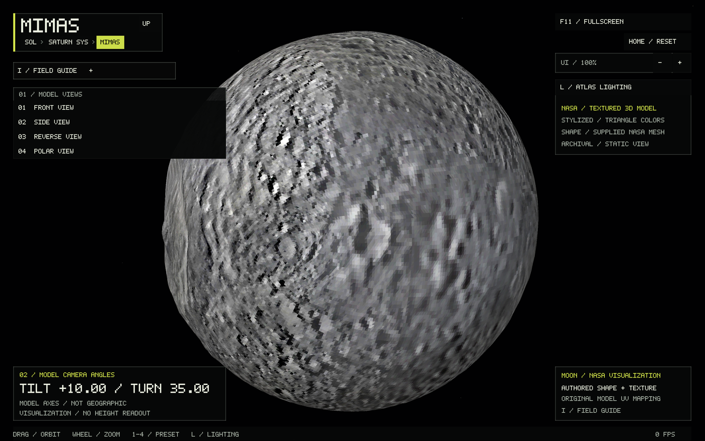
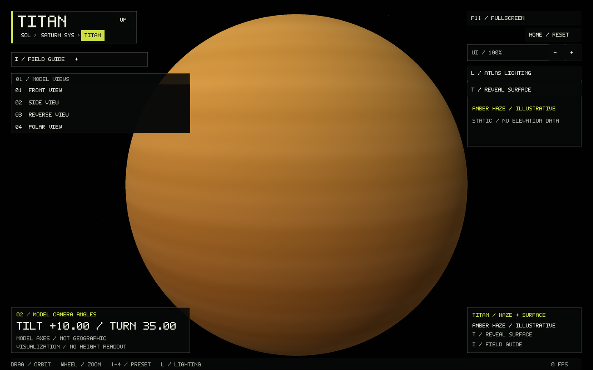
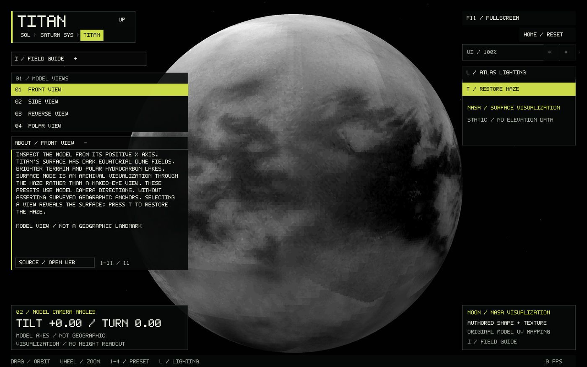
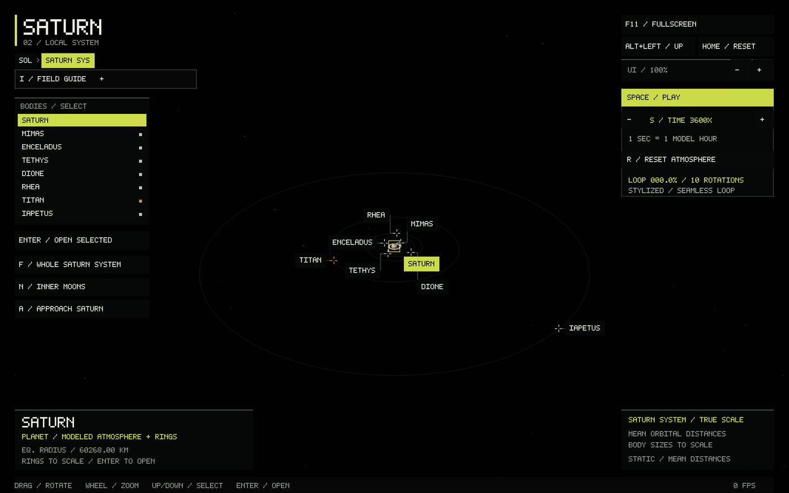
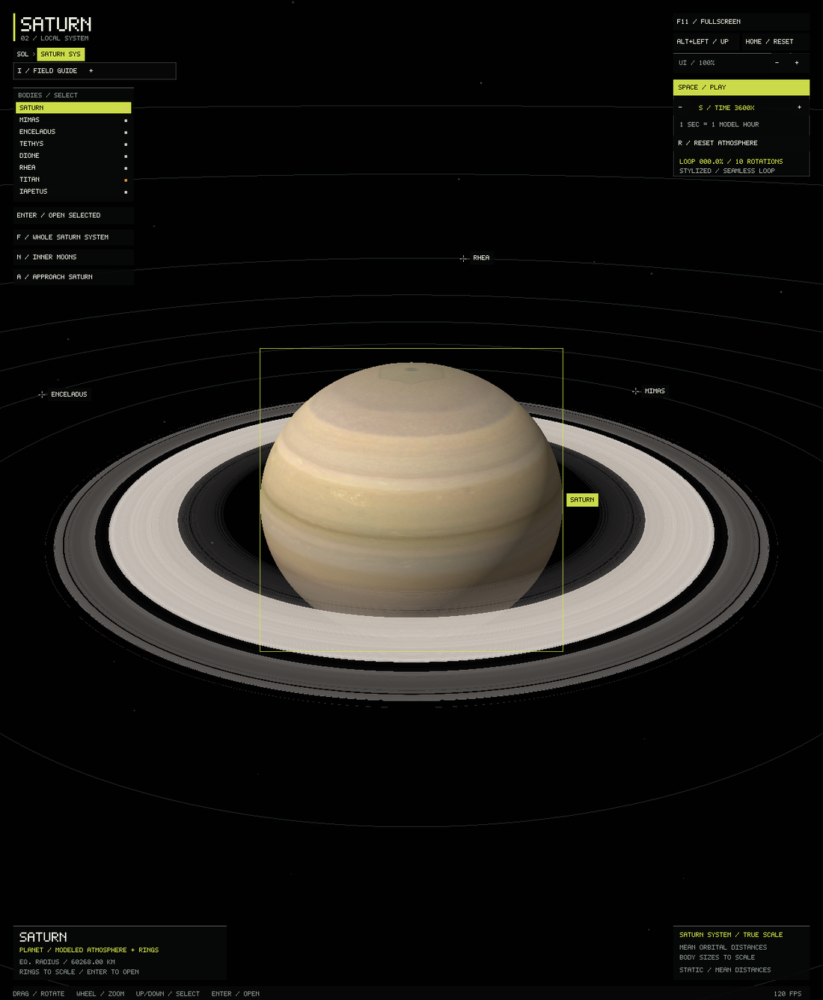

# Titan and the major Saturn moons

All seven major moons now have dedicated explorers: Mimas, Enceladus, Tethys,
Dione, Rhea, Titan and Iapetus. Each has a checked NASA textured visualization,
four model views with contextual notes, a field guide, independent camera and
lighting state, asset retry, and a detailed preview in Saturn's physical system.
This is a representative major-moon catalog, not every satellite of Saturn.

```sh
./build/solar_system_sim --start titan
./build/solar_system_sim --start titan --titan-surface
./build/solar_system_sim --start enceladus
./build/solar_system_sim --start system --body saturn
```

Drag or arrows rotate, wheel or +/− zoom, Home resets the camera, 1–4 selects a
model view, L changes atlas lighting, I opens the guide, and Alt+Left returns to
the Saturn system. R retries a missing or invalid asset. Shared `--lat`, `--lon`,
`--distance`, `--landmark`, `--info`, `--location-info`, and screenshot flags work
with all seven direct start names and `--start globe --body NAME`.

Titan opens behind an opaque, softly shaded amber haze. **T / Reveal surface**
switches to NASA's surface visualization; T restores the haze. Selecting a model
view reveals its surface. Haze, camera and lighting state survive navigation.
The haze is an authored atmosphere illustration, without measured winds, clouds,
an observation date, or an added physical shell radius. The surface is a supplied
visualization through Titan's obscuring atmosphere, not measured optical color.

## One physical scale

The Saturn system uses **1,000,000 km per scene unit** for Saturn, its rings, moon
sizes and centre-to-centre distances. Saturn retains its 60,268 / 54,364 km oblate
reference radii and the [physical ring model](SATURN.md). The moon mean radii come
from [JPL satellite physical parameters](https://ssd.jpl.nasa.gov/sats/phys_par/sep.html).
Mean semimajor axes come from [JPL SAT441 elements](https://ssd.jpl.nasa.gov/sats/elem/sep.html),
epoch 2000-01-01.5 TDB. Sources were checked 29 September 2026.

| Moon | Mean radius, km | Mean orbit from Saturn's centre, km |
|---|---:|---:|
| Mimas | 198.20 | 186,000 |
| Enceladus | 252.10 | 238,400 |
| Tethys | 531.10 | 295,000 |
| Dione | 561.40 | 377,700 |
| Rhea | 763.50 | 527,200 |
| Titan | 2,574.76 | 1,221,900 |
| Iapetus | 734.30 | 3,561,700 |

Each NASA mesh is uniformly calibrated so its volume-equivalent radius matches
JPL's mean radius. Mimas's irregular outline is retained; Tethys retains the
source's modest flattening. The other supplied models are approximate spheres.
Their bounding/equivalent-radius ratios are 1.0615142192004612 for Mimas,
1.0070996774340248 for Tethys, and 1.0002920208926382 for the other five.
There is no independent enlargement of small moons or compression of orbital
distances. Subpixel moons have labeled locator crosses and remain selectable.

**F / Whole system** includes Iapetus; **N / Inner moons** approaches the compact
inner group; **A / Approach selected** frames the selected body, including rings when Saturn is selected. Home restores
the whole system. Returning from a globe preserves framing and moon selection.
The orbit guides remain static coplanar circles at mean distances with authored
angular positions. Inclinations, eccentricities, present positions, synchronous
orientations and an ephemeris are not simulated.

## Pinned NASA sources

Credit for all seven: **NASA Visualization Technology Applications and
Development (VTAD)**. The model pages identify these as visualization assets.
They do not specify surveyed coordinate-frame or global elevation accuracy.
Four presets therefore describe supplied model axes rather than claiming exact
geographic feature centres. The guides discuss geological features as context.
No image brightness or normal-map value is interpreted as terrain height.

- [Mimas model page](https://science.nasa.gov/resource/mimas-3d-model/):
  [GLB source](https://assets.science.nasa.gov/content/dam/science/psd/solar/2023/09/m/Mimas_1_1000.glb).
  SHA256 `66fc9c4b5f89313afa1a8214763525232608e37560044a614eb7cfaa876c47b1`.
- [Enceladus model page](https://science.nasa.gov/resource/enceladus-3d-model/):
  [GLB source](https://assets.science.nasa.gov/content/dam/science/psd/solar/2023/09/e/Enceladus_1_504.glb).
  SHA256 `7548234bae15047d6c1af6bec4f348748b1acae7d4e7bfbe50e5bb3dda75506f`.
- [Tethys model page](https://science.nasa.gov/resource/tethys-3d-model/):
  [GLB source](https://assets.science.nasa.gov/content/dam/science/psd/solar/2023/09/t/Tethys_1_1077-1.glb).
  SHA256 `5e195fa1faf454f7af6808d74a9416b0f97321536a0fcacc5687c0428a9d8659`.
- [Dione model page](https://science.nasa.gov/resource/dione-3d-model/):
  [GLB source](https://assets.science.nasa.gov/content/dam/science/psd/solar/2023/09/d/Dione_1_1123.glb).
  SHA256 `9feee62be971d47ef55448e58304072e89d973c3a3454c812314e1f9dca27674`.
- [Rhea model page](https://science.nasa.gov/resource/rhea-3d-model/):
  [GLB source](https://assets.science.nasa.gov/content/dam/science/psd/solar/2023/09/r/Rhea_1_1529.glb).
  SHA256 `9cb351462fdc149303de79f9b8e33fb3deb9ce60102a190876a7ad280f307d57`.
- [Titan model page](https://science.nasa.gov/resource/titan-surface-3d-model/):
  [GLB source](https://assets.science.nasa.gov/content/dam/science/psd/solar/2023/09/t/TitanSurface_1_5150.glb).
  SHA256 `086a5c1214c20f47dda068a49958a337b51e07b0477128d284408ac2f2676f4b`.
- [Iapetus model page](https://science.nasa.gov/resource/iapetus-3d-model/):
  [GLB source](https://assets.science.nasa.gov/content/dam/science/psd/solar/2023/09/i/Iapetus_1_1471.glb).
  SHA256 `7a7212ac69e022cf37ae96fe4d34f04e9cfea00fd66a266aa3b1c970c475746d`.

## Reproduction and checked format

Download the linked GLBs, then use Python's standard library and ImageMagick:

```sh
python3 tools/prepare_saturn_moons.py mimas /path/to/Mimas_1_1000.glb /tmp/mimas-nasa.mesh
python3 tools/prepare_saturn_moons.py titan /path/to/TitanSurface_1_5150.glb /tmp/titan-nasa.mesh
```

Use the corresponding body name and source for each remaining moon. The tool
pins SHA256, refuses overwrite, and validates source glTF layout. It follows the
material's **base-color texture** reference, preserving original UV islands.
Mimas also includes a blue normal map; that texture is deliberately not used as
surface color. Two planar subdivisions per source triangle improve color
sampling without inventing topography. Each face receives a 5-bit RGB color.
Nearly zero-area polar slivers in the six sphere models are discarded after
float32 normalization; the existing Phobos/Deimos conversion is unchanged.

Output: one ASCII `BODY_MESH 1 VERTEX_COUNT FNV1A64` line, then little-endian
float32 XYZ and RGBA8 records. Runtime checks identity, version, bounded count,
exact length, checksum, finite coordinates, normalized bounds, outward winding
and opaque, equal colors at each triangle's vertices. Failures retain navigation
and a labeled fallback; R retries. CMake packages all seven assets.

Mimas has 174,880 triangles; each other moon has 327,168. Assets and GPU vertex
buffers occupy about 98 MiB total. They load on first entry to the corresponding
globe or the Saturn system and remain cached until exit. First-entry loading may
briefly pause rendering, as with the existing faceted moons.

## Faint space backdrop

Every solar, system and globe view now shares a nearly black backdrop with
sparse, dim stars. Stars are deterministic directions at infinity: rotating the
camera reveals another part of the sky, while translation does not create false
nearby parallax. Perspective and aspect ratio are shared with the foreground.
There is no twinkling, dense wallpaper, bright nebula or real star catalog.
The fullscreen background writes no depth and is drawn before bodies, so it
cannot show through an opaque planet or obscure a transparent ring. The shader
needs no bitmap asset or new runtime dependency.

## Verification

All 15 CTest targets pass. New checks cover each source mesh, outward facets,
volume calibration against JPL radii, orbital spacing, labels, whole/inner/approach
framing, saved system state, guides, checked-file rejection and Titan's display
controls. Mimas's color check guards against accidentally using its normal map.
Native OpenGL renders were inspected for all seven globes, both Titan modes and
the physical system. The space backdrop was also checked in existing renderers.







