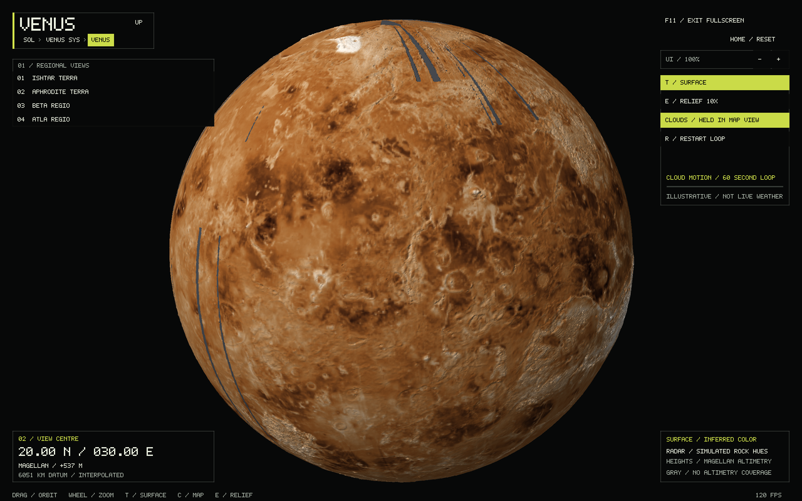
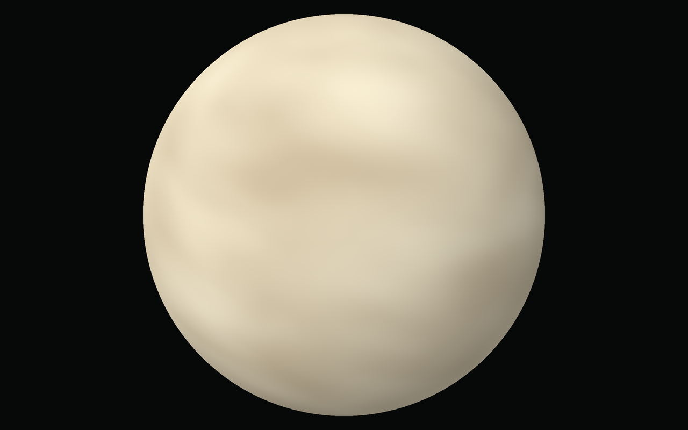

# Venus: clouds and inferred-color terrain

Open **Venus → Venus**, or run `./build/solar_system_sim --start venus`.
The same camera is retained when switching maps and when leaving/re-entering Venus.

| Control | Action |
| --- | --- |
| T or C / map button | Switch opaque clouds and inferred-color terrain |
| E / relief button | Select 1× or 10× relief in surface mode |
| Space | Pause/resume in cloud mode |
| R | Restart clouds; retry loading after an asset error |
| 1–4 | Ishtar Terra, Aphrodite Terra, Beta Regio, Atla Regio |
| Drag / wheel | Rotate / zoom |
| Home | Reset camera |
| Alt+Left / Up button | Return to Venus's system |

`--venus-topography` opens the inferred-color terrain view. `--venus-paused` and
`--venus-phase 0..60` are also available.
Generic `--lat`, `--lon`, `--distance`, `--relief`, `--landmark`, and screenshot
options work. The local system has the same map/animation controls, with relief
fixed at 1×. Cloud mode opens without loading the surface assets. The detailed
terrain and color map load on the first switch to surface mode and stay cached.
Disabled relief and pause controls leave the other mode's saved settings intact.

## Terrain source and preparation

Source: USGS Astrogeology, [Venus Magellan Global Topography 4641m v02](https://astrogeology.usgs.gov/search/map/Venus/Magellan/RadarProperties/Venus_Magellan_Topography_Global_4641m_v02).
The product derives from the 1997 GTDR release. Its signed elevations are metres
above a **6,051,000-metre sphere**, not Venus's 6,051.8-km mean radius. The source
range is −2,951 to +11,687 metres. Map coordinates are east-positive longitude,
with rows from north to south and columns from −180° to +180°.

Download and convert offline (Python with NumPy and Pillow):

```sh
curl -L --fail https://planetarymaps.usgs.gov/mosaic/Venus_Magellan_Topography_Global_4641m_v02.tif -o /tmp/venus-magellan.tif
python3 tools/prepare_venus.py /tmp/venus-magellan.tif assets/venus-magellan.dem
```

The converter refuses to overwrite output and pins the source SHA-256:
`92dd2c8850b128f9dcceb400f1367e3df96229f5309840fee4275b74f192ea11`.
It validates the TIFF dimensions and georeferencing, decodes its uncompressed
signed strips, and averages 2×2 source cells to a 4096×2048 grid (~9.28 km at
the equator). If any contributing cell lacks data, the output cell stays missing.
No synthetic elevation or gap filling is applied.

The bundled `assets/venus-magellan.dem` is a 16-MiB little-endian signed int16
payload with a versioned header and FNV-1a checksum checked at runtime. Missing
cells retain −32768. Readouts use bilinear sampling; missing interpolation
neighbours with nonzero weight produce “no altimetry coverage.” Exact valid cell
centres remain readable beside gaps, and exact poles use the valid last-row mean
independently of longitude. Gray triangles mark missing data;
they use zero-height geometry only to keep the display sphere closed.
Polar geometry uses the valid last-row mean where available.

The globe uses 4,194,304 faceted triangles (240 MiB GPU geometry), sampled from
the prepared grid. Relief changes geometry only, never the reported elevations.
Surface color now comes from the radar composite described below, with stylized
lighting. This is regional altimetry, not ground-level terrain. Loading briefly
blocks the first surface frame while preparing and uploading the mesh. Cloud-only
visits avoid this 240-MiB GPU allocation and the associated terrain preparation.
Missing/corrupt assets show a recoverable message in both the globe and local
system HUD; R retries after the files are restored. T returns to the working
cloud view. A surface-load failure does not discard the cloud renderer, camera,
or saved pause state. The terminal identifies the failing asset and reason.

## Inferred surface color and Pioneer reference

The terrain view uses warm ochre/brown simulated rock hues in place of the former
elevation palette. Color follows radar surface structure, independently of height
and the 1×/10× relief setting. Magellan elevations, the 6,051-km reference sphere,
height readouts, and gray markers for missing altimetry retain their meaning.

Pioneer Venus's [PDS radar archive](https://pds.nasa.gov/ds-view/pds/viewProfile.jsp?dsid=P12-V-ORAD-5-RADAR-IMAGE-V1.0)
includes radius, microwave temperature, reflectivity, and radar-derived slope
products. The original [PVEN001A topography label](https://pds-geosciences.wustl.edu/premgn/mg_1001/pvvenus/radar/pven001a.lbl)
specifies 2880 × 1440 samples, 32-bit VAX real **planetary radii in kilometres**,
at 8 pixels/degree. These are radar measurements, not visible colors. That grid
was reviewed as a reference; it does not replace or fill the bundled Magellan DEM.

The appearance asset is JPL's 1440 × 720 [Magellan/Venera/Pioneer composite](https://maps.jpl.nasa.gov/tmaps/venus.html),
`ven0ajj2.tif`, credited to **NASA/JPL-Caltech (McAuley)**. Its radar mosaic includes
Pioneer and Venera imagery in Magellan gaps. Source rows run north to south, with
zero east longitude at the horizontal center. The bright Maxwell Montes region
was checked against the DEM to verify registration. Composite seams and uneven
radar coverage remain in the archival image; it is not a uniform-resolution
optical photograph. Mipmapping filters the display texture at smaller scales.

NASA's [simulated global Venus view](https://science.nasa.gov/resource/computer-simulated-global-view-of-venus/)
explains the use of radar imagery and simulated hues based on Venera 13/14 color
images. The [NASA SVS terrain visualization](https://svs.gsfc.nasa.gov/3728/)
also distinguishes simulated natural-looking surface color from measured global
color, which has not been mapped. Our renderer slightly reduces the composite's
orange saturation and adds facet lighting. The result is an **inferred appearance**,
not a measured global albedo, mineral-composition map, or view through the clouds.

Download and prepare offline (Python 3 and ImageMagick):

```sh
curl -L --fail https://maps.jpl.nasa.gov/tmaps/pix/ven0ajj2.tif -o /tmp/venus-jpl-radar.tif
python3 tools/prepare_venus_surface.py /tmp/venus-jpl-radar.tif assets/venus-surface.rgb
```

The converter pins source SHA-256
`59a749343de9cc5121a6d470b44b6e59dec15edaf9232ce5ec46427bdcea7bc0`
and refuses to overwrite existing output. The checked `VENUS_RGB 1 1440 720`
header precedes 3,110,400 RGB8 bytes (FNV-1a `3ab216376a45ed44`). Runtime loading
checks the dimensions, length, and checksum. Keep both Venus assets with the app;
no image library or network access is required at runtime.



## Clouds

An opaque cloud deck about 70 km above the reference sphere completely hides
terrain. Its warm ivory haze and broad shifting gradients are inspired by
Venus's visible-light appearance, with warmth and cloud contrast gently
emphasized for readability. ESA describes the visible globe
as nearly featureless, with the dramatic changing markings revealed in
[ultraviolet observations](https://www.esa.int/Science_Exploration/Space_Science/Venus_Express/The_light_and_dark_of_Venus).
[MESSENGER's approach image](https://science.nasa.gov/photojournal/approaching-venus-image-2/)
also shows the subdued appearance of the cloud-covered planet.

Only broad procedural scales animate beneath the haze. Fine folded filaments,
cloud bump shading, and bright rim highlights have been removed. A diffuse
lighting gradient and increased haze along grazing paths keep the deck soft
and mute its already faint markings near the limb. Spherical sampling avoids
longitude seams and polar pinching. This approximates the appearance of a
scattering cloud layer; it is not a calibrated scattering or color model.

This is an artistic atmosphere, not an observed cloud map or weather model.
It makes a retrograde turn on a seamless 60-second loop. All local motion uses
integer harmonics of that loop, so both positions and velocities join smoothly.
Clouds use a separate 262,144-triangle indexed shell (16× fewer triangles than
the terrain); the full Magellan mesh is loaded only when needed for topography.
Once loaded, both meshes remain cached. The clock pauses
in topography mode and while Venus is inactive. The
surface camera does not rotate with the clouds. No surface elevation is displayed
in cloud mode. The visual loop is not a physical rotation period.



There are no new runtime dependencies or network requests. CMake copies the
prepared asset beside the executable with the existing assets.

## Checks

`venus_tests` covers DEM and surface-map orientation at Maxwell Montes,
surface-map corruption rejection, missing/truncated assets and malformed headers,
wrapped longitudes,
missing-data geometry, exact samples beside coverage gaps, polar interpolation,
map controls (including disabled controls), cloud pause/reset/wrap, camera
preservation, and parent navigation.
Both rendering modes were exercised with the app's bounded-frame OpenGL check
and screenshots, including both poles and a close longitude-seam view. Paused
renders at 0 and 60 seconds match pixel-for-pixel; frames just before and after
the wrap change smoothly. A camera compensating for bulk rotation confirms that
cloud shapes also evolve locally. Run all checks with
`ctest --test-dir build --output-on-failure`.

Native control checks also verified pixel-identical paused frames and restart,
holding the cloud clock in topography, map/relief buttons, retained regional
camera and relief through system/solar round trips, and the fitted 200% UI.
The 2026-09-29 review passed all 10 CTest targets and the OpenGL checks on the
AMD Radeon 680M. Review captures and the native control driver are in `build/`.

The finishing pass also exercised an isolated bundle with no DEM, no surface
color map, and a corrupt color map. Clouds rendered through each failure; R
successfully loaded the restored assets. Paused cloud captures before and after
all failures/recovery matched pixel-for-pixel outside the FPS counter, as did
the recovered and cached surface frames. Logs confirmed a single terrain upload
across repeated map switches. The recovery driver and captures are in
`build/venus_polish_driver.cpp` and `build/venus-polish-fixture/`.
